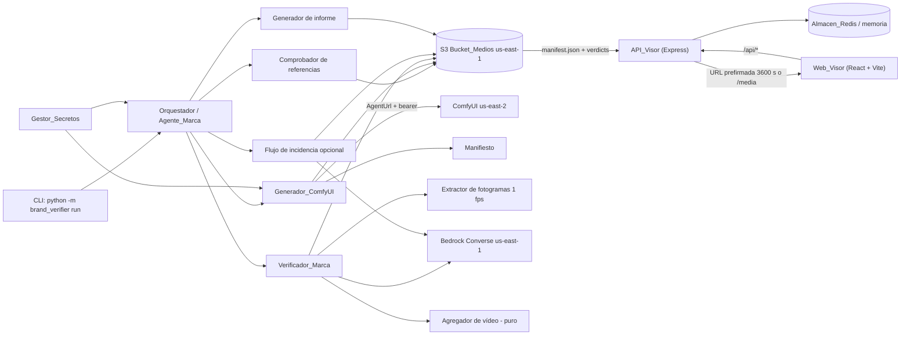
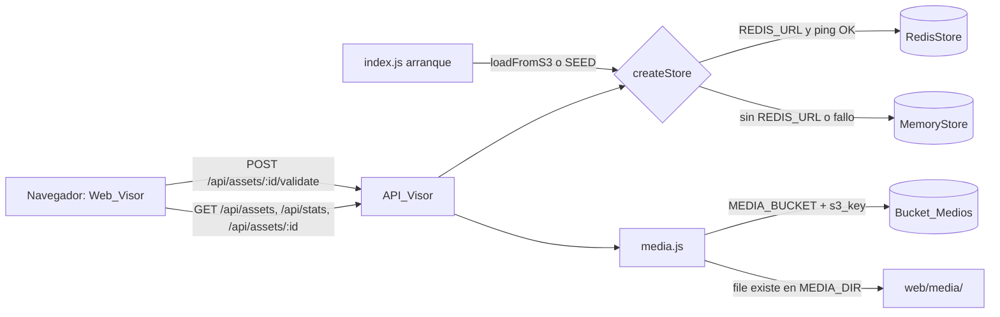
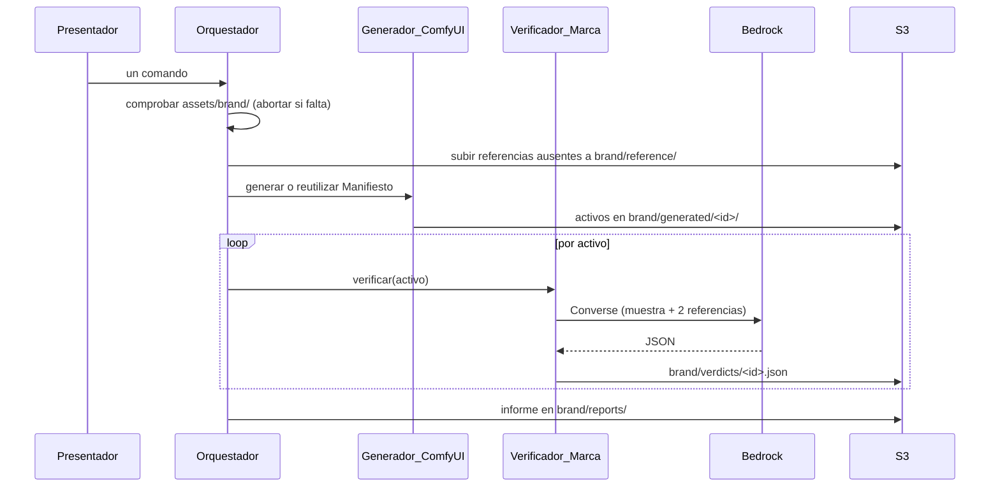

# Design Document

## Overview

Prototipo de un día para el hackathon AWS M&E Agentic AI. El **Verificador de marca** comprueba en imágenes y vídeos que el logotipo mostrado es **Ayesa Digital** (correcto) y no **Ayesa** sin "digital" (incorrecto). Todo se construye en `us-east-1` (Bedrock denegado en `us-east-2`).

Decisiones principales y su justificación:

- **Modelo multimodal de Bedrock vía Converse API**: acepta varias imágenes (muestra + ambos logos de referencia) y permite pedir salida JSON estricta. Se configura por variable de entorno `BRAND_MODEL_ID` (por defecto un perfil de inferencia de Claude con visión disponible en `us-east-1`), para poder cambiarlo sin tocar código.
- **Núcleo puro y capas de E/S finas**: la agregación de veredictos de vídeo, la validación del esquema, la serialización, el cálculo de Precision_Global y la redacción de PAN son funciones puras. Bedrock, S3, ComfyUI y Secrets Manager quedan detrás de adaptadores finos. Esto permite pruebas basadas en propiedades sobre el núcleo y mocks para la E/S.
- **Regla de vídeo conservadora**: un solo fotograma `INCORRECTO` hace `INCORRECTO` el vídeo. La agregación es un cálculo sobre el conjunto de veredictos, por lo que es independiente del orden (confluencia).
- **Generación con ComfyUI únicamente** (`comfyui/client.py` contra `AgentUrl`), un trabajo a la vez. Sin Nova Reel.
- **Secuencialidad por diseño**: la GPU es compartida y los trabajos se encolan; el orquestador procesa un activo cada vez.
- **Sin secretos en el repositorio**: el `Gestor_Secretos` los lee en tiempo de ejecución desde Secrets Manager, CloudFormation o variables de entorno y un filtro de logs los sustituye por `[REDACTED]`.
- **Web de visualización (Requirement 13)**: un `Web_Visor` React (Vite) consume un `API_Visor` Express (Node.js, ESM) que lee los activos del Bucket_Medios (o de datos semilla) y los sirve desde un `Almacen_Redis` con fallback a memoria. Se separa del paquete Python: la única integración es el contrato de datos (`manifest.json` y `brand/verdicts/<id>.json`).
- **Redis como almacén de consulta**: la demo necesita filtrar por tipo, marca esperada y marca detectada. Redis ofrece sets de índice e intersección (`SINTER`) en una sola operación, arranque trivial (`docker-compose`) y un modelo de claves que se explica en una diapositiva. Se descartan DynamoDB (requeriría recurso AWS y GSIs para cada combinación de filtros) y SQLite/Postgres (más pesado para un volumen de ~12-50 activos). El almacén en memoria con la misma interfaz garantiza que la demo funcione sin Redis.

Investigación resumida que informa el diseño:

- `comfyui/client.py` expone `run_workflow`, `upload_image`, `apply_overrides` y `parse_overrides`; usa solo la biblioteca estándar y autentica con `Authorization: Bearer`. Su `timeout_s` por defecto es 1800, por lo que el diseño pasa 900 explícitamente (Requirement 5.5).
- `comfyui/catalog.json` define los ajustes por flujo. `product-shot` y `ad-multishot` aceptan `product_photo` + `use_product_photo=true` para insertar el logotipo/producto como imagen de entrada; `image-to-video` toma `image`; `promo-from-video` toma `video`. `smoke_overrides` ofrece resoluciones/duraciones mínimas.
- `client.py` no permite cancelar un trabajo ni acepta un timeout de 10 s para la conexión de forma específica: el adaptador añade un sondeo previo a `AgentUrl` con timeout de 10 s y, ante un timeout de ejecución, llama a `POST /interrupt` de ComfyUI para cancelar (comportamiento a verificar durante la implementación).
- Los modelos TwelveLabs solo leen vídeos del bucket de la misma región; por eso los vídeos se suben al `Bucket_Medios` (`us-east-1`).

## Architecture



Arquitectura de la web (Requirement 13):



Arranque del API_Visor (`index.js`): crea el almacén (`createStore(REDIS_URL)`), intenta `loadFromS3()` si hay `MEDIA_BUCKET`, usa `SEED` si no hay datos o S3 falla, vacía el almacén (`clear`) y carga cada activo con `upsert`. Si existe `web/client/dist`, el mismo proceso sirve el cliente compilado.

Flujo de extremo a extremo (Requirement 9.1):



Etapas del orquestador: `referencias` → `generacion` → `verificacion` → `informe`. Si una etapa falla, se marca fallida, se omiten las dependientes, se genera un informe parcial y el proceso termina con código distinto de cero (Requirement 9.8).

## Components and Interfaces

Paquete Python `brand_verifier/` (Python 3.11+, `boto3`, `Pillow`, `opencv-python-headless` o `ffmpeg` para fotogramas, `hypothesis` y `pytest` para pruebas).

### Gestor_Secretos (`secrets.py`)

```python
def get_agent_url() -> str          # CFN output AgentUrl (us-east-2) -> env COMFY_URL
def get_agent_token() -> str        # Secrets Manager AgentTokenSecret (us-east-2) -> env COMFY_AGENT_TOKEN
def get_optional(name: str) -> str  # CanvasUrl user/password, clave Stability: outputs o env, nunca a disco
class SecretNotFound(Exception)     # contiene solo el NOMBRE del secreto
```

Cada consulta tiene timeout total de 30 s; si falla en todas las fuentes lanza `SecretNotFound(nombre)`. Un `logging.Filter` global sustituye valores de secretos cargados por `[REDACTED]`.

### Comprobador de referencias (`references.py`)

- `check_local_refs(dir) -> None`: valida existencia, tamaño ≤ 1 MB y que Pillow abra el WebP; si no, lanza `ReferenceError` con ruta y motivo (Requirement 1.3, 1.5).
- `sync_refs_to_s3(s3, bucket)`: sube a `brand/reference/` los archivos ausentes (1.4).

### Verificador_Marca (`verifier.py`)

```python
def verify_image(path_or_bytes, asset_id) -> Verdict | VerifyError
def verify_video(path, asset_id) -> Verdict | VerifyError
def aggregate_frames(frame_verdicts: list[FrameVerdict]) -> Valor_Veredicto   # PURA
def validate_verdict(obj: dict) -> list[str]                                  # PURA, lista de campos inválidos
def verdict_to_json(v: Verdict) -> str ; def verdict_from_json(s: str) -> Verdict
```

Comportamiento de `verify_image`:

1. Rechaza formatos distintos de PNG/JPEG/WebP o tamaño > 5 MB antes de invocar a Bedrock.
2. Construye una petición Converse con: prompt de sistema (reglas de decisión del Requirement 2), imagen de muestra, `Logo_Correcto` y `Logo_Incorrecto` etiquetados por texto, y petición de JSON conforme al esquema.
3. Timeout de 30 s; ante error, salida no JSON o esquema inválido reintenta **una vez**; si vuelve a fallar registra y devuelve `VerifyError` sin `veredicto`.
4. Normaliza reglas: si hay evidencias de ambos logos, fuerza `INCORRECTO` (2.6); `SIN_LOGO` implica evidencias vacías (4.4).

Comportamiento de `verify_video`: extrae 1 fotograma/s (máx. 60 s), verifica cada fotograma con la lógica de imagen (marca de tiempo = segundo), agrega con `aggregate_frames` y selecciona evidencias: todas las de fotogramas `INCORRECTO`/`AMBIGUO` más al menos un `CORRECTO` si existe (3.6). Si falla la apertura o extracción, devuelve `VerifyError` (3.7). Un análisis opcional con Pegasus (flag `--pegasus`) añade un campo `complementario` en el informe, sin alterar el veredicto (3.8).

Regla de agregación (`aggregate_frames`):

| Condición sobre el conjunto de fotogramas | Resultado |
|---|---|
| contiene `INCORRECTO` | `INCORRECTO` |
| sin `INCORRECTO`, contiene `AMBIGUO` | `AMBIGUO` |
| sin `INCORRECTO` ni `AMBIGUO`, contiene `CORRECTO` | `CORRECTO` |
| todos `SIN_LOGO` | `SIN_LOGO` |

### Generador_ComfyUI (`generator.py`)

```python
def generate_dataset(plan: list[AssetSpec], manifest: Manifest) -> Manifest
def run_job(spec: AssetSpec) -> Path | Failure
```

- Sondea `AgentUrl` con timeout de 10 s; sube el logotipo de referencia esperado con `client.upload_image` y lo pasa en el ajuste del flujo (`product_photo`/`use_product_photo=true`, o `image` para `image-to-video`).
- Llama a `client.run_workflow(..., timeout_s=900, token=...)`; ante timeout o error registra `GENERACION_FALLIDA` con motivo y continúa con el siguiente; sin reintentos.
- Un único trabajo en vuelo: bucle secuencial con estados `en cola`, `en curso`, `completado`, `fallido` impresos al cambiar.
- Plan por defecto (≥ 12 activos): imágenes con `product-shot` (3 correcto, 3 incorrecto, 1 sin logo); vídeos con `image-to-video` a partir de una imagen generada (2 correcto, 2 incorrecto, 1 sin logo, ajustes mínimos de `smoke_overrides` ajustados para 3–10 s). Un vídeo ATM de calle con el logotipo en pantalla (prompt sin personas reales, números de tarjeta ni bancos reales). Un vídeo `INCORRECTO` mixto: dos clips (uno con Logo_Incorrecto, otro con Logo_Correcto) concatenados con `ffmpeg` (6.5).
- Registra cada activo en el Manifiesto con `etiqueta_validada=false` (6.6) y lo sube a `brand/generated/<id>/`.

### Manifiesto (`manifest.py`)

- `load/save` con escritura atómica local (archivo temporal + `rename`) y subida a S3; si la subida falla se conserva la última versión escrita con éxito (7.7).
- `validate_asset(id, confirmed: bool, corrected_label: str | None)` fija `etiqueta_validada=true` y guarda la etiqueta corregida (6.7). Subcomando `brand_verifier validate <id> [--label X]`.

### Adaptador S3 (`s3io.py`)

`put/get/exists` con reintentos 1, 2 y 4 s; tras el tercer reintento marca la operación fallida, notifica operación y activo, y mantiene los datos locales pendientes (7.6).

### Flujo de incidencia opcional (`incident.py`)

- `validate_incident(obj) -> list[str]` (PURA): descripción 1–2000, `atm_id` 1–50 alfanumérico/guion, ubicación 1–200, fecha-hora ISO 8601 con zona.
- `redact_pan(text) -> str` (PURA): reemplaza secuencias de 13–19 dígitos (con espacios o guiones) por `*` salvo los últimos 4.
- Persiste `incidents/<id>/incident.json` (≤ 5 s); triaje con modelo de texto de Bedrock a `triage.json`, un reintento y estado `TRIAJE_FALLIDO` si falla.
- `scene_prompt(incident) -> str` produce el texto de escena sin nombres de personas, números de tarjeta ni entidades bancarias.

### Generador de informe (`report.py`)

- `compute_precision(rows) -> float` (PURA) sobre activos con `etiqueta_validada=true`.
- `render_report(rows, stats) -> str` (HTML): tabla por activo (id, tipo, esperada, detectada, resultado, confianza, evidencia), imagen de evidencia con caja dibujada con Pillow o URL prefirmada de 3600 s, Precision_Global, tiempo medio, indicador "OBJETIVO ALCANZADO"/"OBJETIVO NO ALCANZADO" (umbral 90 %) y sección separada de falsos negativos (`INCORRECTO` clasificado `CORRECTO`). Se guarda en `brand/reports/`.

### CLI y orquestador (`cli.py`)

`python -m brand_verifier run [--manifest brand/generated/manifest.json] [--skip-generation]`. Imprime nombre y estado de cada etapa en ≤ 1 s. Si el Manifiesto o la ruta no existen o no son legibles, termina con código distinto de cero sin iniciar etapas posteriores (9.7). Con activos ya generados, verificación e informe en ≤ 600 s (9.10), verificando activos con un pool pequeño de hilos (4) ya que Bedrock admite concurrencia.

### API_Visor (`web/server/`)

Node.js (ESM) con Express, `compression`, `ioredis` y AWS SDK v3 (`@aws-sdk/client-s3`, `s3-request-presigner`). Módulos:

- `app.js` → `createApp(store, { distDir })`: rutas, validación y cabeceras (`X-Content-Type-Options: nosniff`, sin `x-powered-by`, `express.json({ limit: '10kb' })`). Sirve `/media` desde `MEDIA_DIR` y, si hay `distDir`, el cliente compilado con fallback a `index.html` para rutas no `/api` ni `/media`.
- `store.js` → `RedisStore`, `MemoryStore`, `createStore(url)`.
- `stats.js` → `computeStats(assets)` (PURA).
- `media.js` → `mediaUrl(asset)`, `loadFromS3()`, `s3Enabled()`.
- `seed.js` → `SEED`: activos de demostración con veredictos (los mismos esquemas del Manifiesto y del Veredicto).
- `index.js` → arranque descrito en Architecture.

Endpoints (exactamente cinco):

| Método y ruta | Comportamiento |
|---|---|
| `GET /api/health` | `{ ok: true, store: "redis" \| "memory", s3: boolean }` |
| `GET /api/assets` | Lista filtrada por `tipo` (`imagen`\|`video`), `esperada`, `detectada` (Valor_Veredicto). Un filtro con valor no permitido se ignora (`cleanFilter`). Cada elemento omite `veredicto` y añade `detectada` y `confianza` (nulos sin Veredicto). `Cache-Control: public, max-age=5` |
| `GET /api/assets/:id` | 400 si `id` no cumple `^[A-Za-z0-9_-]{1,64}$`; 404 `{error:"no encontrado"}`; si existe, el activo completo (con `veredicto`) más `mediaUrl` |
| `GET /api/stats` | Resultado de `computeStats` sobre todos los activos. `Cache-Control: public, max-age=5` |
| `POST /api/assets/:id/validate` | Cuerpo opcional `{ "label": Valor_Veredicto }`. 400 si `id` o `label` inválidos (sin modificar); 404 si no existe; si no, `upsert` con `etiqueta_esperada = label ?? original` y `etiqueta_validada = true`; responde `{ ok: true }` |

Cualquier error inesperado responde 500 `{error:"error interno"}` sin volcar detalles. Configuración solo por `REDIS_URL`, `MEDIA_BUCKET`, `PORT` (3001 por defecto) y `MEDIA_DIR` (por defecto `web/media/`), más credenciales AWS estándar.

`computeStats(assets)` devuelve `total`, `validados` (activos con `etiqueta_validada` y Veredicto), `aciertos` (validados cuyo `veredicto.veredicto == etiqueta_esperada`), `precision` (porcentaje con 1 decimal; 0 si no hay validados), `objetivo` (`OBJETIVO ALCANZADO` si la precisión sin redondear es ≥ 90, si no `OBJETIVO NO ALCANZADO`), `falsosNegativos` (ids con esperada `INCORRECTO` y detectada `CORRECTO`), `tiempoMedioS` (media de `duracion_s` numéricos, 1 decimal, 0 si no hay) y los recuentos `porEsperada` y `porDetectada` por Valor_Veredicto.

`mediaUrl(asset)` resuelve en este orden: URL prefirmada de S3 de 3600 s si `MEDIA_BUCKET` y `s3_key`; ruta `/media/<archivo>` si `file` existe en `MEDIA_DIR`; en otro caso `null`. `loadFromS3()` lee `brand/generated/manifest.json` y, por cada activo, `brand/verdicts/<id>.json` (Veredicto `null` si no existe).

### Almacen_Redis y almacén en memoria (`store.js`)

Interfaz común (asíncrona): `connect()`, `clear()`, `upsert(asset)`, `get(id)`, `list({ tipo, esperada, detectada })` y `name`.

- `RedisStore`: `upsert` lee el activo anterior, retira su id de los índices anteriores, escribe `asset:{id}`, mantiene el score previo en `assets:all` (o `Date.now()` si es nuevo) y añade el id a los índices nuevos en un pipeline. `list` intersecta con `SINTER` los sets de los filtros presentes y devuelve los ids en el orden de `assets:all` (`ZRANGE`), recuperándolos con `MGET`.
- `MemoryStore`: `Map` por id con el filtrado equivalente por predicado; conserva el orden de inserción.
- `createStore(url)`: si hay `url` intenta `connect()` (conexión y `PING`); si falla, registra un aviso y devuelve `MemoryStore`.

Nota de operación: `clear()` ejecuta `FLUSHDB` en el arranque, por lo que la instancia de Redis debe ser dedicada a la demo (el `docker-compose.yml` de `web/` la levanta aislada).

### Web_Visor (`web/client/src/`)

React + Vite. `api.js` encapsula las llamadas `/api/*`; `App.jsx` contiene los componentes:

- `App`: estado de filtros, activos, estadísticas, activo abierto y error (`role="alert"`); recarga con `refresh()` al cambiar filtros; agrupa por tipo en secciones "Imágenes (n)" y "Vídeos (n)"; muestra "Sin resultados." si la lista está vacía sin error.
- `Stats`: Precision_Global con `aciertos/validados`, objetivo, total, tiempo medio y falsos negativos (ids o "ninguno").
- `Filters`: selects con `<label>` para Tipo, Marca esperada y Detectada.
- `AssetCard`: botón con `aria-label="Abrir <id>"`; resultado "Aprobado" si `detectada == etiqueta_esperada`, "Fallido" si no.
- `Detail`: diálogo `role="dialog"` `aria-modal="true"`, cierre con botón "Cerrar" o Escape; muestra marcas, confianza, recomendación, lista de Evidencias, "Confirmar etiqueta" y selector "Corregir etiqueta"; tras validar recarga el detalle y llama a `onChanged` para refrescar galería y resumen.
- `Media`: imagen o vídeo (o aviso "Sin medio disponible." con el archivo esperado) y capa de cajas.

Funciones puras a extraer de `Media` a `web/client/src/bbox.js` para poder probarlas:

```js
export function bboxToStyle([x0, y0, x1, y1]) // -> { left, top, width, height } en "%"
export function visibleEvidences(asset, t)    // imagen: todas; vídeo: |timestamp_s - t| <= 0.5
```

### Permisos IAM (mínimo privilegio)

`bedrock:InvokeModel` (y `InvokeModelWithResponseStream`/`Converse` según el perfil), `s3:GetObject`/`PutObject`/`ListBucket` limitado a los prefijos `brand/*` e `incidents/*` del `Bucket_Medios`, `secretsmanager:GetSecretValue` sobre `AgentTokenSecret` y `cloudformation:DescribeStacks` en `us-east-2`. El `API_Visor` solo necesita `s3:GetObject` sobre `brand/*` (lectura del Manifiesto, veredictos y medios; las URL prefirmadas se firman con esas mismas credenciales).

### Prevención de secretos

Hook de pre-commit (`scripts/check_secrets.py`) que escanea los archivos staged con patrones de claves/contraseñas/tokens; ante coincidencia aborta el commit y muestra ruta y línea, nunca el valor (10.6). `Agent.md`, informe, manifiesto y logs no incluyen Datos_Sensibles.

## Data Models

### Veredicto

```json
{
  "veredicto": "CORRECTO | INCORRECTO | SIN_LOGO | AMBIGUO",
  "confianza": 0.93,
  "evidencias": [
    {
      "timestamp_s": 3,
      "bbox": [0.12, 0.30, 0.45, 0.52],
      "logo_detectado": "CORRECTO | INCORRECTO"
    }
  ],
  "recomendacion": "Sustituir el logotipo por Ayesa Digital."
}
```

Invariantes: `confianza` en [0,1]; `recomendacion` de 1 a 500 caracteres; `0 <= x_min < x_max <= 1` y `0 <= y_min < y_max <= 1`; `INCORRECTO` → ≥ 1 evidencia y recomendación que menciona Ayesa Digital; `CORRECTO` → ≥ 1 evidencia; `SIN_LOGO` → evidencias vacías. `timestamp_s` es 0 para imágenes. Clave S3: `brand/verdicts/<id_activo>.json` con `id_activo` en `^[A-Za-z0-9_-]{1,64}$`. Un Veredicto que no cumple el esquema se rechaza con la lista de campos inválidos y no se guarda (4.8).

### Manifiesto (`brand/generated/manifest.json`)

```json
{
  "assets": [
    {
      "id": "img-correcto-01",
      "tipo": "imagen | video",
      "flujo": "product-shot",
      "ajustes": {"width": 1024, "height": 1024, "use_product_photo": true},
      "etiqueta_esperada": "CORRECTO",
      "etiqueta_validada": false,
      "estado": "GENERADO | GENERACION_FALLIDA",
      "motivo": null,
      "s3_key": "brand/generated/img-correcto-01/output.png"
    }
  ]
}
```

`ajustes` nunca contiene tokens, URLs con credenciales ni contraseñas.

### Resultado de verificación (fila de informe)

```json
{"id": "...", "tipo": "imagen", "esperada": "CORRECTO", "detectada": "CORRECTO",
 "resultado": "aprobado | fallido", "confianza": 0.93, "evidencia": {"frame_s": 0, "bbox": [..]},
 "duracion_s": 7.4, "validada": true}
```

### Incidencia

```json
{"id": "uuid", "descripcion": "...", "atm_id": "ATM-0042", "ubicacion": "...",
 "fecha_hora": "2025-01-01T10:00:00+01:00"}
```

Triaje: `{"categoria": "TARJETA_RETENIDA|TARJETA_NO_DEVUELTA|FALLO_MANIPULACION|OTRA", "severidad": "BAJA|MEDIA|ALTA", "causa_probable": "...", "accion_recomendada": "..."}`.

### Activo del visor (unidad almacenada por el Almacen_Redis)

Es el registro del Manifiesto más el Veredicto y campos de visualización:

```json
{
  "id": "vid-mixto-01",
  "tipo": "imagen | video",
  "flujo": "image-to-video",
  "file": "vid-mixto-01.mp4",
  "s3_key": "brand/generated/vid-mixto-01/output.mp4",
  "etiqueta_esperada": "INCORRECTO",
  "etiqueta_validada": false,
  "duracion_s": 7.4,
  "narrativa": "texto opcional de contexto",
  "veredicto": { "veredicto": "...", "confianza": 0.9, "evidencias": [], "recomendacion": "..." }
}
```

`veredicto` es `null` cuando aún no existe `brand/verdicts/<id>.json`. `file`, `duracion_s` y `narrativa` son opcionales.

### Modelo de claves en Redis

| Clave | Tipo | Contenido |
|---|---|---|
| `asset:{id}` | string | JSON completo del activo |
| `assets:all` | sorted set | ids; score = marca de tiempo de la primera inserción (define el orden y se conserva en las actualizaciones) |
| `idx:tipo:<imagen\|video>` | set | ids por tipo |
| `idx:esperada:<Valor_Veredicto>` | set | ids por etiqueta esperada |
| `idx:detectada:<Valor_Veredicto\|NONE>` | set | ids por Valor_Veredicto detectado; `NONE` si no hay Veredicto |

Un listado con filtros es la intersección de los sets de los filtros presentes, ordenada por `assets:all`. Sin filtros devuelve todos los ids de `assets:all`.

### Fallback en memoria

`MemoryStore` guarda el mismo objeto en un `Map` por id y aplica el filtro por predicado. Se activa si `REDIS_URL` no está definida o la conexión falla; ambas implementaciones deben ser indistinguibles desde la API (mismos ids, mismo orden, mismo objeto devuelto por `get`).

### Respuesta de `GET /api/stats`

```json
{"total": 12, "validados": 10, "aciertos": 9, "precision": 90.0, "objetivo": "OBJETIVO ALCANZADO",
 "falsosNegativos": ["vid-mixto-01"], "tiempoMedioS": 7.4,
 "porEsperada": {"CORRECTO": 5, "INCORRECTO": 5, "SIN_LOGO": 2, "AMBIGUO": 0},
 "porDetectada": {"CORRECTO": 5, "INCORRECTO": 4, "SIN_LOGO": 2, "AMBIGUO": 0}}
```

### Entradas de entorno (solo nombres, sin valores)

`AgentUrl`, `AgentTokenSecret`, `CanvasUrl`, `AudienceDataURI`, `HackathonAssetsBucketName`, `MediaToolkitIngestBucket`, `MediaToolkitRegion`, `MediaToolkitStackName`, `TestVideosURI`; variables `COMFY_URL`, `COMFY_AGENT_TOKEN`, `BRAND_MODEL_ID`, `AWS_REGION=us-east-1`. API_Visor: `REDIS_URL` (sin credenciales en el repositorio), `MEDIA_BUCKET`, `PORT`, `MEDIA_DIR`.

## Correctness Properties

*A property is a characteristic or behavior that should hold true across all valid executions of a system-essentially, a formal statement about what the system should do. Properties serve as the bridge between human-readable specifications and machine-verifiable correctness guarantees.*

Las propiedades se aplican al núcleo puro (agregación, validación, serialización, redacción, métricas, informe) y, para la web (Properties 23 a 31), a `computeStats`, `cleanFilter`, la validación de la API, la interfaz común de los almacenes y las funciones puras del cliente. La salida del modelo multimodal, ComfyUI y S3 se cubren con tests de integración y con la medición de Precision_Global.

### Property 1: Agregación de vídeo por reglas de prioridad

*For any* lista no vacía de Valor_Veredicto de fotogramas, `aggregate_frames` devuelve `INCORRECTO` si contiene alguno; si no, `AMBIGUO` si contiene alguno; si no, `CORRECTO` si contiene alguno; y `SIN_LOGO` si todos lo son.

**Validates: Requirements 3.2, 3.3, 3.4, 3.5**

### Property 2: Agregación independiente del orden

*For any* lista de veredictos de fotogramas y cualquier permutación de ella, `aggregate_frames` devuelve el mismo Valor_Veredicto.

**Validates: Requirements 3.9**

### Property 3: Selección de evidencias de vídeo

*For any* lista de fotogramas verificados, las evidencias del vídeo incluyen la de cada fotograma `INCORRECTO` o `AMBIGUO` y, si existe algún fotograma `CORRECTO`, al menos una de ellos.

**Validates: Requirements 3.6**

### Property 4: Muestreo a 1 fotograma por segundo

*For any* duración de vídeo entre 1 y 60 segundos, las marcas de tiempo de muestreo son estrictamente crecientes, separadas por 1 segundo y no exceden la duración.

**Validates: Requirements 3.1**

### Property 5: Validación del esquema del Veredicto

*For any* objeto candidato, `validate_verdict` devuelve una lista vacía si y solo si: `veredicto` es uno de los cuatro valores, `confianza` está en [0,1], `recomendacion` tiene entre 1 y 500 caracteres, cada caja cumple `0 <= min < max <= 1`, `INCORRECTO` tiene ≥ 1 evidencia y una recomendación que menciona Ayesa Digital, `CORRECTO` tiene ≥ 1 evidencia y `SIN_LOGO` tiene evidencias vacías; en caso contrario la lista nombra cada campo inválido.

**Validates: Requirements 4.1, 4.2, 4.3, 4.4, 4.5, 4.8**

### Property 6: Ida y vuelta del Veredicto

*For any* Veredicto válido, `verdict_from_json(verdict_to_json(v))` es equivalente a `v`, y volver a serializar produce el mismo JSON.

**Validates: Requirements 4.7**

### Property 7: Validez del identificador de activo

*For any* cadena, se acepta como `id_activo` si y solo si tiene entre 1 y 64 caracteres alfanuméricos, guiones o guiones bajos, y la clave resultante es `brand/verdicts/<id>.json`.

**Validates: Requirements 4.6**

### Property 8: Ambos logos implican INCORRECTO

*For any* salida cruda del modelo que contenga evidencias de `CORRECTO` e `INCORRECTO` a la vez, la normalización asigna `INCORRECTO` y conserva una evidencia por cada logotipo.

**Validates: Requirements 2.6**

### Property 9: Rechazo de imágenes no soportadas

*For any* par (formato, tamaño), la imagen se acepta si y solo si el formato es PNG, JPEG o WebP y el tamaño es ≤ 5 MB; si se rechaza, no se invoca a Bedrock.

**Validates: Requirements 2.7**

### Property 10: Entrada de generación según etiqueta

*For any* AssetSpec, la imagen de entrada adjuntada es exclusivamente el Activo_Referencia de la marca esperada, y ninguna cuando la etiqueta es `SIN_LOGO`.

**Validates: Requirements 6.3**

### Property 11: Registro nuevo en el Manifiesto

*For any* AssetSpec generado, su registro en el Manifiesto contiene tipo, flujo, ajustes y etiqueta esperada, tiene `etiqueta_validada=false` y no contiene ningún valor secreto.

**Validates: Requirements 6.6**

### Property 12: Validación manual de etiquetas

*For any* Manifiesto y activo, tras `validate_asset` el activo tiene `etiqueta_validada=true` y su etiqueta esperada es la corregida si se proporcionó, o la original si no; los demás activos no cambian.

**Validates: Requirements 6.7**

### Property 13: Precision_Global solo sobre activos validados

*For any* conjunto de filas de resultados, `compute_precision` es igual al porcentaje de filas con `etiqueta_validada=true` cuya detección coincide con la esperada sobre el total de filas validadas, e ignora las no validadas.

**Validates: Requirements 6.8, 9.4**

### Property 14: Indicador de objetivo

*For any* valor de Precision_Global, el informe contiene "OBJETIVO ALCANZADO" si es ≥ 90 % y "OBJETIVO NO ALCANZADO" en caso contrario.

**Validates: Requirements 9.5**

### Property 15: Falsos negativos separados

*For any* conjunto de filas, la sección de falsos negativos contiene exactamente las filas con esperada `INCORRECTO` y detectada `CORRECTO`.

**Validates: Requirements 9.6**

### Property 16: Contenido del informe

*For any* conjunto de filas, el informe contiene, por cada activo, su identificador, tipo, marca esperada, Valor_Veredicto detectado, resultado (aprobado si coinciden, fallido si no), confianza y referencia a la evidencia.

**Validates: Requirements 9.2, 9.3**

### Property 17: Validación de Incidencia

*For any* objeto candidato, `validate_incident` devuelve vacío si y solo si todos los campos obligatorios cumplen sus límites y la fecha-hora es ISO 8601 con zona; en caso contrario nombra cada campo inválido y no se persiste nada.

**Validates: Requirements 8.1, 8.2**

### Property 18: Redacción de números de tarjeta

*For any* texto que contenga secuencias de 13 a 19 dígitos (consecutivos o agrupados con espacios o guiones), `redact_pan` deja visibles solo los últimos 4 dígitos de cada secuencia, sustituye el resto por `*` y deja intacto el texto restante.

**Validates: Requirements 8.3**

### Property 19: Prompt de escena sin datos sensibles

*For any* descripción de Incidencia, el prompt de escena producido no contiene secuencias de 13 o más dígitos.

**Validates: Requirements 8.6**

### Property 20: Ida y vuelta de la Incidencia

*For any* Incidencia válida, parsear su serialización JSON y volver a serializar produce un objeto equivalente.

**Validates: Requirements 8.7**

### Property 21: Detección de secretos sin revelarlos

*For any* texto con un valor con formato de clave, contraseña o token insertado en una línea, el escáner de pre-commit reporta la ruta y el número de esa línea, y su salida no contiene el valor.

**Validates: Requirements 10.6**

### Property 22: Redacción en logs

*For any* secreto cargado y cualquier mensaje de log que lo contenga, el mensaje emitido no contiene el secreto y contiene `[REDACTED]` en su lugar.

**Validates: Requirements 10.7**

### Property 23: Precision_Global solo sobre validados, en rango

*For any* conjunto de activos, `computeStats.precision` es igual a `aciertos / validados * 100` redondeado a 1 decimal, donde `validados` son los activos con `etiqueta_validada=true` y Veredicto y `aciertos` los que coinciden con la etiqueta esperada; es 0 si no hay validados; está siempre entre 0 y 100; y añadir o modificar activos no validados no la cambia.

**Validates: Requirements 13.8, 13.37**

### Property 24: Coherencia del resto de estadísticas

*For any* conjunto de activos, `computeStats` devuelve `objetivo = "OBJETIVO ALCANZADO"` si y solo si la precisión sin redondear es ≥ 90; `falsosNegativos` contiene exactamente los ids con esperada `INCORRECTO` y detectada `CORRECTO` (todos pertenecen al conjunto); `tiempoMedioS` es la media a 1 decimal de los `duracion_s` numéricos (0 si no hay); y la suma de `porEsperada` y de `porDetectada` no supera `total`, y la de `porEsperada` es igual al número de activos con etiqueta esperada válida.

**Validates: Requirements 13.9, 13.10, 13.37**

### Property 25: Consistencia de filtros entre RedisStore y MemoryStore

*For any* secuencia de `upsert` de activos (incluidas actualizaciones de un mismo id que cambian tipo, etiqueta esperada o Veredicto) y *for any* combinación de filtros `tipo`, `esperada` y `detectada`, `list` de `RedisStore` y de `MemoryStore` devuelven los mismos ids en el mismo orden (el de primera inserción), y todos cumplen todos los filtros indicados, sin omitir ningún activo que los cumpla; un activo actualizado deja de aparecer bajo sus valores anteriores.

**Validates: Requirements 13.3, 13.24, 13.25, 13.26**

### Property 26: Filtros inválidos se ignoran

*For any* valor de los parámetros `tipo`, `esperada` y `detectada`, `GET /api/assets` aplica solo los filtros cuyo valor pertenece al conjunto permitido; el resultado con un parámetro inválido es igual al resultado sin ese parámetro.

**Validates: Requirements 13.4**

### Property 27: Validación de identificador y etiqueta

*For any* par (id, label), `POST /api/assets/:id/validate` y `GET /api/assets/:id` responden 400 si `id` no cumple `^[A-Za-z0-9_-]{1,64}$` (y, en el POST, si `label` está presente y no es uno de los cuatro Valor_Veredicto), sin modificar ningún activo; con entrada válida y activo inexistente responden 404 con "no encontrado".

**Validates: Requirements 13.19, 13.20**

### Property 28: Validación manual de un activo en la API

*For any* activo existente y *for any* `label` válido, tras `POST /api/assets/:id/validate` con `label` el activo tiene `etiqueta_esperada = label` y `etiqueta_validada=true`; sin `label` conserva su etiqueta original y `etiqueta_validada=true`; en ambos casos el resto de campos y los demás activos no cambian y la respuesta es `{ ok: true }`.

**Validates: Requirements 13.17, 13.18**

### Property 29: Ida y vuelta de upsert y get en los almacenes

*For any* activo válido, en `RedisStore` y en `MemoryStore`, `get(a.id)` tras `upsert(a)` devuelve un objeto equivalente a `a`; y `upsert` repetido del mismo activo no cambia el resultado de `get` ni duplica el id en `list`.

**Validates: Requirements 13.38**

### Property 30: Mapeo de caja normalizada a porcentajes CSS

*For any* caja válida `[x_min, y_min, x_max, y_max]` con `0 <= x_min < x_max <= 1` y `0 <= y_min < y_max <= 1`, `bboxToStyle` devuelve `left = x_min*100%`, `top = y_min*100%`, `width = (x_max-x_min)*100%` y `height = (y_max-y_min)*100%`, y la caja resultante queda dentro del 0 al 100 % del medio (`left + width <= 100`, `top + height <= 100`, con tolerancia de redondeo).

**Validates: Requirements 13.13**

### Property 31: Evidencias visibles de un vídeo según el instante

*For any* lista de Evidencias y cualquier instante de reproducción `t`, `visibleEvidences` para un vídeo devuelve exactamente las Evidencias con `|timestamp_s - t| <= 0.5`, y para una imagen devuelve todas.

**Validates: Requirements 13.14, 13.13**

## Error Handling

| Situación | Comportamiento |
|---|---|
| Falta un Activo_Referencia o no es un WebP legible | Abortar antes de cualquier etapa con ruta y motivo (1.3, 1.5) |
| Imagen no soportada o > 5 MB | Rechazo sin invocar a Bedrock (2.7) |
| Bedrock falla, JSON inválido o > 30 s | Un reintento; si falla de nuevo, `VerifyError` sin veredicto, registrado (2.8) |
| Vídeo ilegible o sin fotogramas | `VerifyError` con motivo (3.7) |
| Veredicto no conforme al esquema | Rechazo con campos inválidos; no se guarda (4.8) |
| `AgentUrl` sin respuesta en 10 s o trabajo > 900 s | Cancelar, activo `GENERACION_FALLIDA` con motivo, continuar (5.5) |
| Secreto ausente | Abortar en ≤ 30 s nombrando el secreto, nunca su valor (5.6, 10.4) |
| Fallo de S3 | 3 reintentos (1, 2, 4 s); luego marcar fallida y conservar datos locales (7.6); el Manifiesto conserva la última escritura buena (7.7) |
| Incidencia inválida | Rechazo con campos inválidos, sin persistir (8.2) |
| Triaje fallido tras reintento | Estado `TRIAJE_FALLIDO`, sin `triage.json` (8.5) |
| Manifiesto o ruta ilegible | Código de salida ≠ 0, sin etapas posteriores (9.7) |
| Fallo de una etapa | Marcarla fallida, omitir dependientes, informe parcial, código ≠ 0 (9.8) |
| Secreto detectado antes de commit | Bloquear commit, mostrar ruta y línea (10.6) |
| `REDIS_URL` ausente o Redis no responde | Aviso en log y `MemoryStore`; `GET /api/health` informa `store: "memory"` (13.26) |
| S3 ilegible o sin activos al arrancar el API_Visor | Aviso con el nombre del error (sin datos sensibles) y carga de `SEED` (13.27) |
| Veredicto ausente en S3 (`brand/verdicts/<id>.json`) | Activo con `veredicto: null`; `detectada: null` y `idx:detectada:NONE` (13.28) |
| `id` o `label` inválidos en la API | 400 `{error}` sin modificar datos; 404 `no encontrado` si no existe (13.19, 13.20) |
| Cuerpo de petición > 10 KB | Rechazo por `express.json` antes de procesar el contenido (13.33) |
| Error interno no previsto en la API | 500 `{error:"error interno"}`; el detalle solo va al log del servidor |
| Sin medio resoluble | `mediaUrl: null`; el Web_Visor muestra "Sin medio disponible." con el archivo esperado (13.31) |
| Fallo de una petición del Web_Visor | Mensaje de error en pantalla con `role="alert"` (13.22) |

Todos los mensajes de error y logs pasan por el filtro de redacción; nunca incluyen valores de secretos.

## Testing Strategy

**Enfoque dual**: tests unitarios para ejemplos, bordes e integración, y tests basados en propiedades para el núcleo puro.

**Biblioteca PBT**: `hypothesis` con `pytest` para el paquete Python (Properties 1 a 22) y `fast-check` (dependencia de desarrollo, versión fijada) ejecutado con el runner `node:test` ya presente en `web/server/app.test.js` para la web (Properties 23 a 31). No se implementa PBT desde cero. `fast-check` es opcional para la demo: si no se instala, las Properties 23 a 31 se cubren con tests de `node:test` basados en ejemplos y generadores aleatorios simples, y se reintroduce `fast-check` cuando haya tiempo.

**Configuración**:
- Cada propiedad de la sección Correctness Properties se implementa con **un único** test de Hypothesis (Python) o `fc.assert(fc.property(...), { numRuns: 100 })` (Node) con 100 ejecuciones como mínimo.
- Cada test lleva un comentario con el formato `// Feature: atm-card-incident-video-simulation, Property N: <texto de la propiedad>` (o `#` en Python).
- Property 25 y 29 usan `MemoryStore` como modelo y un Redis real (contenedor local de `docker-compose`) o `ioredis-mock`; con Redis real se reducen las ejecuciones (p. ej. 30) por coste y se vacía la base con `clear()` entre casos. Si no hay Redis disponible, el test de `RedisStore` se omite con aviso (`skip`) y la propiedad se comprueba solo sobre `MemoryStore`.
- Properties 26, 27 y 28 arrancan `createApp(new MemoryStore())` en un puerto efímero (`listen(0)`), como ya hace `boot()` en `app.test.js`.
- Properties 30 y 31 prueban `bbox.js` (módulo puro extraído de `App.jsx`) sin renderizar React.

**Dónde NO se usa PBT** (y por qué):
- Salida del modelo multimodal (2.2-2.5): no determinista; se mide con el dataset generado y la Precision_Global del informe.
- Llamadas a ComfyUI, S3, Secrets Manager y Bedrock: tests de integración con 1 a 3 ejemplos, y mocks para reintentos, timeouts y concurrencia máxima de 1 trabajo (5.4, 5.5, 7.6, 7.7, 2.8).
- Rendimiento (2.9, 9.10) y contenido generado (6.4, 6.5, 6.9): comprobación en la demo con revisión humana.
- Documentación y configuración (TEAM.md, Agent.md, IAM, tamaño de archivos): smoke tests con scripts simples (conteo de palabras, secciones `##`, coincidencia con `requirements.md`).

**Tests existentes de la web** (`web/server/app.test.js`, `npm test` con `node --test`): cubren un ejemplo de `computeStats` (precisión solo sobre validados y falsos negativos) y la API (listado con filtro, detalle, 404, id inválido 400 y label inválido 400). Se mantienen y las propiedades 23 a 31 los generalizan.

**Web: dónde NO se usa PBT**:
- Renderizado de `App.jsx` (galería, resumen, diálogo, textos "Sin resultados." / "Sin evidencias." / "Sin medio disponible.", accesibilidad `role="dialog"`, `aria-modal`, `aria-label`, `role="alert"`, Escape): pruebas de componente con `@testing-library/react` y `fetch` simulado, o revisión manual en la demo (13.5 a 13.7, 13.11, 13.12, 13.15, 13.16, 13.21, 13.22, 13.34 a 13.36).
- Modelo de claves de Redis (13.23), carga desde S3 y URL prefirmadas (13.28, 13.29): integración con Redis local y cliente S3 simulado, 1 a 3 ejemplos.
- `media.js` con archivo local o ausente (13.30, 13.31), límite de 10 KB (13.33), fallback `createStore` con URL inválida (13.26), arranque con `SEED` (13.27) y `GET /api/health` (13.2): ejemplos y smoke tests.
- Endpoints exactos (13.1) y configuración solo por entorno (13.32): smoke test y revisión estática (búsqueda de `process.env` en `web/server`).

**Tests unitarios y de ejemplo**:
- Referencias: ausente, no WebP, > 1 MB, subida a S3 si falta.
- Verificador con cliente Bedrock falso: la petición contiene muestra y ambos logos; un fallo → reintento; dos fallos → error.
- Generador con `run_workflow` falso: timeout → `GENERACION_FALLIDA` y continúa; ejecución secuencial.
- CLI: Manifiesto ausente → código ≠ 0; etapa fallida → informe parcial.
- Gestor_Secretos: orden de fuentes (CloudFormation/Secrets Manager → variable de entorno) y mensaje solo con el nombre.

**Prueba de extremo a extremo**: `python -m brand_verifier run` con el dataset generado; se revisa manualmente cada activo y se marca `etiqueta_validada=true` antes de calcular la Precision_Global objetivo (≥ 90 %).
