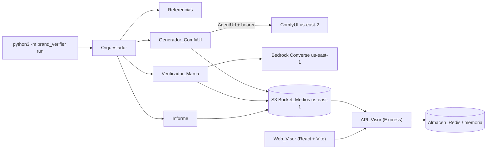

# Agent.md: Verificador de marca (Ayesa Digital frente a Ayesa)

Documento que consolida las especificaciones del prototipo (hackathon AWS M&E Agentic AI). Fuente: `.kiro/specs/atm-card-incident-video-simulation/`. Ningún valor secreto aparece aquí: solo nombres de Outputs, secretos y variables.

## Contexto

Prototipo de un día. El **Verificador_Marca** comprueba en imágenes y vídeos que el logotipo mostrado es **Ayesa Digital** (CORRECTO) y no **Ayesa** sin la palabra "digital" (INCORRECTO). Ayesa Digital debe ser la marca correcta en todo momento.

- Usuario: equipo de marca, marketing y cumplimiento (ver `TEAM.md`: problema, usuario, justificación del agente, datos y métrica).
- Métrica de éxito: Precision_Global >= 90 % sobre los Activos_Prueba validados y < 60 s de verificación por activo.
- Región: `us-east-1` para Bedrock y todo lo que se construye (Bedrock está denegado en `us-east-2`). `us-east-2` solo para leer stacks del evento y el secreto del token de ComfyUI (`--region us-east-2`).
- Modelos: Amazon Bedrock multimodal vía Converse API; el identificador se toma de la variable `BRAND_MODEL_ID`.
- Todas las imágenes y vídeos de prueba se generan con ComfyUI (nunca con Nova Reel). El ATM de calle con incidencia de tarjeta es solo contexto narrativo de un vídeo y flujo secundario.

### Activos_Referencia

| Marca | Archivo local | Copia en S3 (Bucket_Medios, `us-east-1`) |
|---|---|---|
| Logo_Correcto (Ayesa Digital) | `assets/brand/logo-ayesa-boletin.webp` | `brand/reference/logo-ayesa-boletin.webp` |
| Logo_Incorrecto (Ayesa) | `assets/brand/logo-vector_ayesa.webp` | `brand/reference/logo-vector_ayesa.webp` |

Cada archivo es WebP legible de hasta 1 MB. Si falta alguno en `assets/brand/`, el Sistema aborta antes de cualquier etapa. Si falta en `brand/reference/`, se sube.

### Verificador_Marca y regla de vídeo

El Verificador_Marca recibe una imagen (PNG, JPEG o WebP, hasta 5 MB) o un vídeo (MP4, hasta 60 s), invoca Bedrock con la muestra y ambos Activos_Referencia y devuelve un Veredicto con un Valor_Veredicto: `CORRECTO`, `INCORRECTO`, `SIN_LOGO` o `AMBIGUO`. Si aparecen ambos logotipos en la misma imagen, el resultado es `INCORRECTO`.

En vídeo se extrae 1 fotograma por segundo, se verifica cada uno como imagen y se agrega (la agregación no depende del orden):

| Condición sobre los fotogramas | Resultado del vídeo |
|---|---|
| Al menos uno `INCORRECTO` | `INCORRECTO` |
| Ninguno `INCORRECTO`, al menos uno `AMBIGUO` | `AMBIGUO` |
| Ninguno `INCORRECTO` ni `AMBIGUO`, al menos uno `CORRECTO` | `CORRECTO` |
| Todos `SIN_LOGO` | `SIN_LOGO` |

### ComfyUI: AgentUrl y CanvasUrl

- `AgentUrl` es para la API: `comfyui/client.py` lo usa con el token del secreto `AgentTokenSecret`.
- `CanvasUrl` es solo para el navegador (uso manual del canvas). Nunca se llama desde código.
- Un trabajo a la vez, timeout de 10 s de conexión y 900 s por trabajo, sin reintentos (`GENERACION_FALLIDA`).

## Requisitos

Los trece requisitos de `requirements.md`, copiados con el mismo número, título y criterios de aceptación.

### Requirement 1: Activos de referencia de marca

**User Story:** Como responsable de marca, quiero que los logotipos correcto e incorrecto estén en ubicaciones definidas, para que el verificador y la generación de pruebas usen siempre las mismas referencias.

#### Acceptance Criteria

1. THE Sistema SHALL esperar los Activos_Referencia en `assets/brand/logo-ayesa-boletin.webp` (Logo_Correcto) y `assets/brand/logo-vector_ayesa.webp` (Logo_Incorrecto), con un tamaño máximo de 1 MB por archivo.
2. THE Sistema SHALL esperar una copia de cada Activo_Referencia en el Bucket_Medios bajo `brand/reference/` con el mismo nombre de archivo.
3. IF falta algún Activo_Referencia en `assets/brand/`, THEN THE Sistema SHALL abortar antes de iniciar cualquier etapa y mostrar la ruta del archivo ausente y la instrucción de colocarlo en `assets/brand/`.
4. WHEN ambos Activos_Referencia existen localmente y falta alguno en `brand/reference/` del Bucket_Medios, THE Sistema SHALL subir el archivo ausente al Bucket_Medios.
5. IF un Activo_Referencia no es una imagen WebP legible, THEN THE Sistema SHALL abortar e indicar el nombre del archivo y el motivo.
6. THE Sistema SHALL tratar el Logo_Correcto como la única marca válida, de modo que cualquier otro logotipo de Ayesa sin la palabra "digital" sea no conforme.

### Requirement 2: Verificación de imágenes

**User Story:** Como equipo de marketing, quiero verificar una imagen, para saber si muestra el logotipo Ayesa Digital correcto.

#### Acceptance Criteria

1. WHEN se solicita verificar una imagen (PNG, JPEG o WebP de hasta 5 MB), THE Verificador_Marca SHALL invocar un modelo multimodal de Amazon Bedrock en `us-east-1`, proporcionándole la imagen y ambos Activos_Referencia, y SHALL devolver un Veredicto.
2. WHEN el logotipo visible incluye el símbolo y la palabra "digital" bajo el wordmark "ayesa", THE Verificador_Marca SHALL asignar el Valor_Veredicto `CORRECTO`.
3. WHEN el logotipo visible incluye el símbolo y el wordmark "ayesa" sin la palabra "digital", THE Verificador_Marca SHALL asignar el Valor_Veredicto `INCORRECTO`.
4. WHEN la imagen no contiene ningún logotipo de Ayesa, THE Verificador_Marca SHALL asignar el Valor_Veredicto `SIN_LOGO`.
5. IF la imagen contiene un logotipo cuya variante no puede determinarse (por ejemplo, por tamaño inferior al legible, desenfoque u oclusión), THEN THE Verificador_Marca SHALL asignar el Valor_Veredicto `AMBIGUO`.
6. IF la imagen contiene a la vez el Logo_Correcto y el Logo_Incorrecto, THEN THE Verificador_Marca SHALL asignar el Valor_Veredicto `INCORRECTO` y SHALL incluir una Evidencia por cada logotipo.
7. IF el formato de imagen no está soportado o supera 5 MB, THEN THE Verificador_Marca SHALL rechazar la imagen con un mensaje que indique el motivo, sin invocar a Bedrock.
8. IF la invocación a Bedrock falla, devuelve una salida que no es JSON válido conforme al esquema del Veredicto, o supera 30 segundos, THEN THE Verificador_Marca SHALL reintentar una única vez y, si el segundo intento falla, SHALL registrar el error y devolver un resultado de error sin Valor_Veredicto.
9. THE Verificador_Marca SHALL completar la verificación de una imagen en un máximo de 30 segundos en al menos el 90 % de los Activos_Prueba de tipo imagen.

### Requirement 3: Verificación de vídeos

**User Story:** Como equipo de cumplimiento, quiero verificar un vídeo fotograma a fotograma, para garantizar que Ayesa Digital sea la marca correcta en todo momento.

#### Acceptance Criteria

1. WHEN se solicita verificar un vídeo (MP4 de hasta 60 segundos), THE Verificador_Marca SHALL extraer Fotogramas_Muestreados a razón de 1 fotograma por segundo y SHALL verificar cada uno conforme a los criterios del Requirement 2.
2. IF al menos un Fotograma_Muestreado recibe el Valor_Veredicto `INCORRECTO`, THEN THE Verificador_Marca SHALL asignar al vídeo el Valor_Veredicto `INCORRECTO`, con independencia del resto de fotogramas.
3. WHEN ningún Fotograma_Muestreado es `INCORRECTO`, al menos uno es `CORRECTO` y ninguno es `AMBIGUO`, THE Verificador_Marca SHALL asignar al vídeo el Valor_Veredicto `CORRECTO`.
4. WHEN ningún Fotograma_Muestreado es `INCORRECTO` y al menos uno es `AMBIGUO`, THE Verificador_Marca SHALL asignar al vídeo el Valor_Veredicto `AMBIGUO`.
5. WHEN todos los Fotogramas_Muestreados son `SIN_LOGO`, THE Verificador_Marca SHALL asignar al vídeo el Valor_Veredicto `SIN_LOGO`.
6. THE Verificador_Marca SHALL incluir en las evidencias del vídeo la marca de tiempo y la caja delimitadora de cada fotograma `INCORRECTO` o `AMBIGUO`, y al menos un fotograma `CORRECTO` cuando exista.
7. IF el archivo de vídeo no existe, no es legible o no se pueden extraer fotogramas, THEN THE Verificador_Marca SHALL devolver un resultado de error que indique el motivo, sin Valor_Veredicto.
8. WHERE se habilita el análisis con TwelveLabs Pegasus, THE Verificador_Marca SHALL leer el vídeo desde el Bucket_Medios en `us-east-1` y SHALL usar su resultado solo como evidencia complementaria, sin sustituir el Veredicto basado en fotogramas.
9. FOR ALL vídeos, el Valor_Veredicto agregado SHALL ser independiente del orden en que se verifican los Fotogramas_Muestreados (propiedad de confluencia).

### Requirement 4: Esquema y serialización del Veredicto

**User Story:** Como integrador, quiero un Veredicto en JSON con esquema fijo, para consumirlo en informes y en pruebas automáticas.

#### Acceptance Criteria

1. THE Veredicto SHALL contener los campos `veredicto` (exactamente uno de `CORRECTO`, `INCORRECTO`, `SIN_LOGO`, `AMBIGUO`), `confianza` (número entre 0 y 1), `evidencias` (lista de Evidencias) y `recomendacion` (texto de 1 a 500 caracteres).
2. WHEN el Valor_Veredicto es `INCORRECTO`, THE Verificador_Marca SHALL incluir al menos una Evidencia y una recomendación que indique sustituir el logotipo por Ayesa Digital.
3. WHEN el Valor_Veredicto es `CORRECTO`, THE Verificador_Marca SHALL incluir al menos una Evidencia.
4. WHEN el Valor_Veredicto es `SIN_LOGO`, THE Verificador_Marca SHALL devolver una lista de evidencias vacía.
5. THE Verificador_Marca SHALL validar que cada caja delimitadora cumpla `0 <= x_min < x_max <= 1` y `0 <= y_min < y_max <= 1`.
6. WHEN se completa un Veredicto, THE Sistema SHALL guardarlo en el Bucket_Medios bajo `brand/verdicts/<id_activo>.json`, donde `<id_activo>` tiene entre 1 y 64 caracteres alfanuméricos, guiones o guiones bajos.
7. FOR ALL Veredictos válidos, serializar a JSON, parsear y volver a serializar SHALL producir un objeto equivalente (propiedad de ida y vuelta).
8. IF el Veredicto no cumple el esquema, THEN THE Sistema SHALL rechazarlo con un mensaje que nombre cada campo inválido y no guardarlo en el Bucket_Medios.

### Requirement 5: Conexión de Kiro con ComfyUI

**User Story:** Como miembro del equipo, quiero conectar Kiro con ComfyUI, para generar todos los vídeos e imágenes de prueba desde código.

#### Acceptance Criteria

1. WHEN el Generador_ComfyUI necesita ejecutar un flujo, THE Generador_ComfyUI SHALL usar `comfyui/client.py` contra `AgentUrl`, autenticándose con el token del secreto `AgentTokenSecret` leído de AWS Secrets Manager en `us-east-2`.
2. THE Generador_ComfyUI SHALL usar `CanvasUrl` solo para uso manual en navegador y SHALL usar `AgentUrl` para toda llamada de API.
3. WHEN un flujo requiere una imagen de entrada, THE Generador_ComfyUI SHALL subir el Activo_Referencia correspondiente mediante `client.upload_image` y SHALL pasar el nombre devuelto al ajuste del flujo definido en `comfyui/catalog.json` (por ejemplo `product_photo` y `use_product_photo=true` en `product-shot` y `ad-multishot`).
4. THE Generador_ComfyUI SHALL ejecutar como máximo un trabajo de ComfyUI a la vez y SHALL mantener en cola los demás.
5. IF `AgentUrl` no responde en 10 segundos o un trabajo no finaliza en 900 segundos, THEN THE Generador_ComfyUI SHALL cancelar el trabajo, registrar el activo como `GENERACION_FALLIDA` con el motivo y continuar con el siguiente activo, sin reintentos automáticos.
6. IF el token o la URL no se obtienen de ninguna fuente, THEN THE Gestor_Secretos SHALL abortar la operación en un máximo de 30 segundos e indicar el nombre del secreto ausente sin su valor.
7. WHEN el Sistema se ejecuta, THE Sistema SHALL mostrar en consola el flujo en curso y su estado (en cola, en curso, completado o fallido) en un máximo de 1 segundo desde cada cambio.

### Requirement 6: Generación del conjunto de datos con ComfyUI

**User Story:** Como evaluador, quiero un conjunto de imágenes y vídeos con logo correcto, incorrecto y sin logo generados con ComfyUI, para medir la precisión del verificador.

#### Acceptance Criteria

1. THE Generador_ComfyUI SHALL generar todos los Activos_Prueba mediante flujos de `comfyui/workflows/` (por ejemplo `product-shot`, `image-to-video`, `text-to-video`, `promo-from-video`, `thumbnail-from-video`, `upscale-4x`, `vertical-cut`) y SHALL NOT usar Amazon Nova Reel ni ningún otro modelo de vídeo de Bedrock.
2. THE Generador_ComfyUI SHALL generar al menos 12 Activos_Prueba: 3 imágenes y 2 vídeos con Logo_Correcto, 3 imágenes y 2 vídeos con Logo_Incorrecto, y 1 imagen y 1 vídeo sin logotipo.
3. WHEN genera un Activo_Prueba con logotipo, THE Generador_ComfyUI SHALL adjuntar como imagen de entrada únicamente el Activo_Referencia de la marca esperada.
4. THE Generador_ComfyUI SHALL generar al menos un vídeo de prueba cuya escena sea un ATM de calle que muestra en pantalla el logotipo, como contexto narrativo de una incidencia de tarjeta de crédito, sin nombres reales de personas, sin números de tarjeta y sin entidades bancarias reales.
5. THE Generador_ComfyUI SHALL generar al menos un vídeo de prueba `INCORRECTO` en el que el Logo_Incorrecto aparezca solo en parte de los fotogramas y el Logo_Correcto en el resto, para ejercitar la regla del Requirement 3 criterio 2.
6. WHEN un Activo_Prueba se genera, THE Generador_ComfyUI SHALL registrarlo en el Manifiesto con tipo, flujo, ajustes usados (sin secretos), etiqueta esperada y `etiqueta_validada=false`.
7. WHEN una persona revisa un Activo_Prueba y confirma que su contenido corresponde a la etiqueta esperada, THE Sistema SHALL permitir fijar `etiqueta_validada=true` en el Manifiesto; WHEN la persona corrige la etiqueta esperada, THE Sistema SHALL guardar la etiqueta corregida junto con `etiqueta_validada=true`.
8. IF un Activo_Prueba generado no muestra el logotipo de forma reconocible, THEN THE Sistema SHALL mantener `etiqueta_validada=false` hasta que una persona corrija o confirme su etiqueta, y SHALL excluirlo del cálculo de Precision_Global.
9. WHEN los flujos de vídeo se ejecutan, THE Generador_ComfyUI SHALL usar los ajustes de resolución y duración mínimos de `catalog.json` necesarios para que el vídeo tenga entre 3 y 10 segundos.

### Requirement 7: Almacenamiento y trazabilidad en S3

**User Story:** Como analista, quiero que referencias, activos generados, veredictos e informes estén en S3 con rutas predecibles, para localizarlos fácilmente.

#### Acceptance Criteria

1. THE Sistema SHALL almacenar los Activos_Referencia en `s3://me-hack-media-385927210791-us-east-1/brand/reference/`.
2. WHEN el Generador_ComfyUI completa un Activo_Prueba, THE Sistema SHALL guardarlo en `s3://me-hack-media-385927210791-us-east-1/brand/generated/<id_activo>/`, junto con el Manifiesto actualizado en `brand/generated/manifest.json`.
3. WHEN se genera un Informe_Demo, THE Sistema SHALL guardarlo en `brand/reports/` del Bucket_Medios.
4. THE Sistema SHALL usar la región `us-east-1` para todos los recursos AWS construidos y SHALL pasar a los modelos TwelveLabs solo vídeos del Bucket_Medios.
5. THE Sistema SHALL leer los datos de ejemplo desde S3 sin copiar al repositorio ningún archivo de más de 1 MB, con excepción de los Activos_Referencia de `assets/brand/`.
6. IF una operación de S3 falla, THEN THE Sistema SHALL reintentar hasta 3 veces con espera creciente (1, 2 y 4 segundos) y, si el tercer reintento también falla, marcar la operación como fallida, notificar la operación y el activo afectados, y conservar los datos locales pendientes de escritura.
7. WHEN se actualiza el Manifiesto y la escritura falla, THE Sistema SHALL conservar el contenido de la última escritura exitosa.

### Requirement 8: Incidencia de ATM como contexto secundario

**User Story:** Como presentador de la demo, quiero conservar el escenario del ATM de calle, para contextualizar el vídeo de prueba con marca incorrecta.

#### Acceptance Criteria

1. WHERE el flujo de Incidencia está habilitado, WHEN se recibe una Incidencia con descripción (1 a 2000 caracteres), identificador de ATM (1 a 50 caracteres alfanuméricos o guiones), ubicación (1 a 200 caracteres) y fecha-hora ISO 8601 con zona horaria, THE Sistema SHALL asignar un identificador único y persistir la Incidencia como JSON en el Bucket_Medios bajo `incidents/<id>/incident.json` en un máximo de 5 segundos.
2. IF a la Incidencia le falta algún campo obligatorio o incumple los límites del criterio 1, THEN THE Sistema SHALL rechazarla con un mensaje que nombre cada campo inválido, sin persistir ningún objeto.
3. IF la descripción contiene una secuencia de 13 a 19 dígitos consecutivos o agrupados con espacios o guiones, THEN THE Sistema SHALL sustituir todos los dígitos salvo los últimos 4 por `*` antes de persistir.
4. WHERE el flujo de Incidencia está habilitado, WHEN una Incidencia es persistida, THE Agente_Marca SHALL invocar un modelo de texto de Amazon Bedrock en `us-east-1` para producir un triaje JSON con categoría (`TARJETA_RETENIDA`, `TARJETA_NO_DEVUELTA`, `FALLO_MANIPULACION` u `OTRA`), severidad (`BAJA`, `MEDIA` o `ALTA`), causa probable y acción recomendada, y SHALL guardarlo en `incidents/<id>/triage.json`.
5. IF el triaje no es JSON válido conforme al esquema o la invocación falla o supera 30 segundos, THEN THE Agente_Marca SHALL reintentar una vez y, si el segundo intento falla, SHALL marcar la Incidencia como `TRIAJE_FALLIDO` sin guardar `triage.json`.
6. WHERE el flujo de Incidencia está habilitado, THE Agente_Marca SHALL usar la descripción de la Incidencia solo como texto de escena para el prompt del vídeo de ATM del Requirement 6 criterio 4 y SHALL excluir de ese prompt nombres de personas, números de tarjeta y entidades bancarias reales.
7. FOR ALL Incidencias válidas, serializar a JSON, parsear y volver a serializar SHALL producir un objeto equivalente (propiedad de ida y vuelta).

### Requirement 9: Informe y salida de la demo

**User Story:** Como presentador, quiero un informe y un único comando de extremo a extremo, para mostrar el resultado y la precisión del verificador.

#### Acceptance Criteria

1. WHEN el presentador invoca un único comando de línea de comandos, THE Sistema SHALL ejecutar el flujo completo (comprobación de referencias, generación con ComfyUI o reutilización del Manifiesto, verificación e informe) sin otro comando ni intervención manual.
2. WHEN la verificación finaliza, THE Sistema SHALL generar un Informe_Demo en HTML o Markdown con una tabla que contenga, por cada Activo_Prueba: identificador, tipo (imagen o vídeo), marca esperada, Valor_Veredicto detectado, resultado (aprobado si coinciden, fallido si no), confianza y una referencia a la Evidencia (fotograma y marca de tiempo).
3. THE Informe_Demo SHALL incluir, para cada Activo_Prueba con Evidencia, el fotograma o imagen de evidencia con la caja delimitadora dibujada, o una URL prefirmada de 3600 segundos de caducidad al activo.
4. THE Informe_Demo SHALL mostrar la Precision_Global calculada sobre los Activos_Prueba con `etiqueta_validada=true`, y el tiempo medio de verificación por activo en segundos.
5. WHEN la Precision_Global es mayor o igual que 90 %, THE Informe_Demo SHALL indicar "OBJETIVO ALCANZADO"; WHEN es menor que 90 %, THE Informe_Demo SHALL indicar "OBJETIVO NO ALCANZADO".
6. THE Informe_Demo SHALL mostrar de forma separada los falsos negativos (activo `INCORRECTO` clasificado como `CORRECTO`) como la categoría de error más grave.
7. IF el archivo de Manifiesto o la ruta indicada en el comando no existe o no es legible, THEN THE Sistema SHALL terminar con código de salida distinto de cero y un mensaje con el motivo, sin iniciar etapas posteriores.
8. IF una etapa falla, THEN THE Sistema SHALL marcarla como fallida en consola con la causa, omitir las etapas dependientes, generar un Informe_Demo parcial con la etapa fallida indicada y terminar con código de salida distinto de cero.
9. WHEN una etapa cambia de estado, THE Sistema SHALL mostrar su nombre y estado (en curso, completada o fallida) en consola en un máximo de 1 segundo.
10. WHEN el flujo se ejecuta con activos ya generados en el Manifiesto, THE Sistema SHALL completar la verificación y el informe en un máximo de 600 segundos.

### Requirement 10: Gestión de secretos y seguridad

**User Story:** Como responsable del equipo, quiero que ningún secreto se guarde en el repositorio, para evitar filtraciones.

#### Acceptance Criteria

1. WHEN el Sistema necesita el token del agente ComfyUI, THE Gestor_Secretos SHALL obtenerlo desde AWS Secrets Manager (secreto `AgentTokenSecret`, región `us-east-2`) o, si no está disponible, desde la variable de entorno `COMFY_AGENT_TOKEN`.
2. WHEN el Sistema necesita la URL del agente ComfyUI, THE Gestor_Secretos SHALL obtenerla desde el Output `AgentUrl` del stack (con `--region us-east-2`) o, si no está disponible, desde la variable de entorno `COMFY_URL`.
3. WHEN el Sistema necesita el usuario y la contraseña del canvas (`CanvasUrl`) o la clave de Stability AI, THE Gestor_Secretos SHALL obtenerlos desde los Outputs del stack o desde variables de entorno, sin almacenarlos en disco.
4. IF un secreto requerido no se encuentra en ninguna de sus fuentes o la consulta falla, THEN THE Gestor_Secretos SHALL abortar la operación en un máximo de 30 segundos, indicar el nombre del secreto ausente sin su valor y no continuar con credenciales parciales ni vacías.
5. THE Sistema SHALL excluir Datos_Sensibles de todo archivo del repositorio, incluidos `Agent.md`, especificaciones, código, logs, el Manifiesto, el Informe_Demo y `TEAM.md`.
6. IF se detecta un valor con formato de clave o contraseña en un archivo a confirmar, THEN THE Sistema SHALL abortar la verificación previa, impedir la confirmación (commit) y mostrar la ruta y el número de línea afectados sin mostrar el valor.
7. THE Sistema SHALL escribir los registros sustituyendo cualquier valor de token, contraseña o clave por `[REDACTED]`.
8. THE Sistema SHALL usar permisos IAM de mínimo privilegio limitados a `bedrock:InvokeModel` y a lectura/escritura en los prefijos `brand/` e `incidents/` del Bucket_Medios, más `secretsmanager:GetSecretValue` sobre `AgentTokenSecret` y `cloudformation:DescribeStacks` en `us-east-2`. <!-- nosecret: nombre de acción IAM, no un valor -->

### Requirement 11: Alineación con TEAM.md

**User Story:** Como equipo, quiero que TEAM.md refleje el problema, el usuario y la métrica de éxito, para la evaluación de valor de negocio.

#### Acceptance Criteria

1. THE Sistema SHALL mantener en `TEAM.md` las secciones problema, usuario, justificación de usar un agente frente a reglas, datos y métrica de éxito, cada una con entre 1 y 150 palabras.
2. THE `TEAM.md` SHALL definir el problema como la inconsistencia de marca Ayesa frente a Ayesa Digital en imágenes y vídeos, y el usuario como el equipo de marca, marketing y cumplimiento.
3. THE `TEAM.md` SHALL definir la métrica de éxito con dos valores objetivo: Precision_Global mayor o igual que 90 % sobre los Activos_Prueba validados, y un tiempo de verificación por activo inferior a 60 segundos, junto con una línea base de revisión manual expresada en minutos por activo.
4. WHEN cambia el alcance del prototipo, THE equipo SHALL actualizar `TEAM.md` y confirmar el cambio en la misma rama git antes de la presentación al jurado.
5. IF alguna sección de `TEAM.md` falta, está vacía o no coincide con la funcionalidad construida, THEN THE equipo SHALL corregir `TEAM.md` antes de la presentación al jurado.

### Requirement 12: Entregable Agent.md

**User Story:** Como miembro del equipo, quiero un `Agent.md` que consolide las especificaciones, para que cualquier agente o persona implemente el prototipo.

#### Acceptance Criteria

1. THE Agent_md SHALL residir en `/workshop/Agent.md`, estar escrito en español y tener un máximo de 1.000 líneas.
2. THE Agent_md SHALL incluir exactamente ocho secciones con encabezado de nivel 2 y contenido no vacío: contexto, requisitos, arquitectura, flujo del agente, esquemas de datos, gestión de secretos, plan de demo y criterios de aceptación, de modo que la sección de arquitectura describa el Web_Visor, el API_Visor y el Almacen_Redis, y la sección de plan de demo describa el arranque y el uso del Web_Visor.
3. THE Agent_md SHALL describir el Verificador_Marca, la regla de veredicto para vídeos, los Activos_Referencia en `assets/brand/` y `brand/reference/`, la conexión con ComfyUI (`AgentUrl` para la API, `CanvasUrl` solo para navegador) y la web de visualización de resultados (endpoints del API_Visor, modelo de claves del Almacen_Redis y variables de entorno `REDIS_URL`, `MEDIA_BUCKET`, `PORT` y `MEDIA_DIR`).
4. THE Agent_md SHALL listar cada una de las nueve salidas del evento (`AgentUrl`, `AgentTokenSecret`, `CanvasUrl`, `AudienceDataURI`, `HackathonAssetsBucketName`, `MediaToolkitIngestBucket`, `MediaToolkitRegion`, `MediaToolkitStackName`, `TestVideosURI`) con una descripción de su uso de una línea y sin valores secretos.
5. THE Agent_md SHALL indicar el comando `bash media-toolkit/connect.sh` como forma de conectar con el toolkit de medios.
6. IF un valor de salida es secreto (contraseña del canvas, clave de Stability AI, token del agente), THEN THE Agent_md SHALL referenciar solo el nombre del Output y la forma de leerlo (variable de entorno o AWS Secrets Manager) sin incluir el valor.
7. THE Agent_md SHALL contener cada uno de los trece requisitos de `requirements.md`, del Requirement 1 al Requirement 13 (mismo número, título y criterios de aceptación), sin omitir ni contradecir ninguno.
8. IF `requirements.md` y `Agent.md` difieren en algún requisito o criterio, THEN THE Agent_md SHALL considerarse incompleto y el equipo SHALL actualizarlo hasta que ambos coincidan antes de la demo.

### Requirement 13: Web de visualización de resultados

**User Story:** Como presentador de la demo y revisor de marca, quiero una web que muestre imágenes y vídeos de prueba con su veredicto, evidencias y métricas, para revisar los resultados y validar etiquetas sin leer JSON.

#### Acceptance Criteria

1. THE API_Visor SHALL exponer exactamente los endpoints `GET /api/health`, `GET /api/assets`, `GET /api/assets/:id`, `GET /api/stats` y `POST /api/assets/:id/validate`.
2. WHEN se recibe `GET /api/health`, THE API_Visor SHALL responder con `ok=true`, el nombre del almacén en uso (`redis` o `memory`) y un booleano que indica si S3 está habilitado.
3. WHEN se recibe `GET /api/assets` con los parámetros opcionales `tipo` (`imagen` o `video`), `esperada` y `detectada` (cada uno un Valor_Veredicto), THE API_Visor SHALL devolver únicamente los activos que cumplen todos los filtros indicados, incluyendo por cada activo el campo `detectada` (Valor_Veredicto del Veredicto, o nulo si no existe) y el campo `confianza`.
4. IF un parámetro de filtro de `GET /api/assets` tiene un valor fuera de los permitidos, THEN THE API_Visor SHALL ignorar ese filtro y aplicar los restantes.
5. WHEN el Web_Visor se carga, THE Web_Visor SHALL mostrar una galería con los activos agrupados en las secciones "Imágenes" y "Vídeos", cada una con su número de activos, y por cada activo su identificador, flujo, marca esperada, marca detectada y el resultado "Aprobado" o "Fallido" según coincidan ambas.
6. WHEN el usuario cambia el filtro Tipo, Marca esperada o Detectada del Web_Visor, THE Web_Visor SHALL recargar la galería solicitando `GET /api/assets` con los filtros seleccionados.
7. IF la lista de activos recibida está vacía y no hay error, THEN THE Web_Visor SHALL mostrar el texto "Sin resultados.".
8. WHEN se recibe `GET /api/stats`, THE API_Visor SHALL calcular la Precision_Global como el porcentaje, con un decimal, de activos con `etiqueta_validada=true` y Veredicto cuyo Valor_Veredicto coincide con la etiqueta esperada, y SHALL devolver 0 cuando no hay activos validados.
9. WHEN se recibe `GET /api/stats`, THE API_Visor SHALL devolver además el total de activos, el número de activos validados, el número de aciertos, el tiempo medio en segundos con un decimal calculado sobre los activos con `duracion_s` numérico (0 si no hay ninguno), el recuento por etiqueta esperada y por etiqueta detectada, y los identificadores de los falsos negativos (activos con etiqueta esperada `INCORRECTO` y Valor_Veredicto `CORRECTO`).
10. WHEN la Precision_Global es mayor o igual que 90 %, THE API_Visor SHALL devolver el objetivo "OBJETIVO ALCANZADO"; WHEN es menor que 90 %, THE API_Visor SHALL devolver "OBJETIVO NO ALCANZADO".
11. THE Web_Visor SHALL mostrar en un resumen la Precision_Global con sus aciertos sobre validados, el objetivo, el total de activos, el tiempo medio y el número de falsos negativos con sus identificadores (o "ninguno").
12. WHEN el usuario abre un activo de la galería, THE Web_Visor SHALL solicitar `GET /api/assets/:id` y SHALL mostrar un diálogo de detalle con el medio, la marca esperada, la marca detectada, la confianza en porcentaje, la recomendación y la lista de Evidencias.
13. WHEN el activo es una imagen, THE Web_Visor SHALL dibujar sobre el medio una caja por cada Evidencia, con posición y tamaño en porcentaje calculados a partir de la caja delimitadora normalizada `[x_min, y_min, x_max, y_max]` (izquierda = `x_min`, arriba = `y_min`, ancho = `x_max - x_min`, alto = `y_max - y_min`).
14. WHEN el activo es un vídeo, THE Web_Visor SHALL dibujar solo las cajas de las Evidencias cuya marca de tiempo difiere como máximo 0,5 segundos del instante de reproducción actual.
15. WHEN el usuario selecciona una Evidencia de un vídeo, THE Web_Visor SHALL posicionar la reproducción en la marca de tiempo de esa Evidencia.
16. IF el activo no tiene Evidencias, THEN THE Web_Visor SHALL mostrar el texto "Sin evidencias.".
17. WHEN se recibe `POST /api/assets/:id/validate` con un `label` válido, THE API_Visor SHALL guardar `label` como etiqueta esperada del activo y `etiqueta_validada=true`, y SHALL responder `{ "ok": true }`.
18. WHEN se recibe `POST /api/assets/:id/validate` sin `label`, THE API_Visor SHALL conservar la etiqueta esperada, fijar `etiqueta_validada=true` y responder `{ "ok": true }`.
19. IF el identificador no cumple `^[A-Za-z0-9_-]{1,64}$` o el `label` no es uno de `CORRECTO`, `INCORRECTO`, `SIN_LOGO` o `AMBIGUO`, THEN THE API_Visor SHALL responder con código HTTP 400 y un mensaje de error, sin modificar el activo.
20. IF el identificador es válido pero no existe ningún activo con ese identificador en `GET /api/assets/:id` o en `POST /api/assets/:id/validate`, THEN THE API_Visor SHALL responder con código HTTP 404 y el mensaje "no encontrado".
21. WHEN el usuario pulsa "Confirmar etiqueta" o elige una etiqueta en "Corregir a…", THE Web_Visor SHALL invocar `POST /api/assets/:id/validate`, recargar el detalle y refrescar la galería y el resumen.
22. IF una petición del Web_Visor al API_Visor falla, THEN THE Web_Visor SHALL mostrar el mensaje de error en pantalla.
23. WHERE la variable de entorno `REDIS_URL` está definida y Redis responde, THE API_Visor SHALL usar el Almacen_Redis, guardando cada activo como JSON en `asset:{id}`, su orden en el sorted set `assets:all` y su pertenencia en los sets `idx:tipo:<tipo>`, `idx:esperada:<etiqueta>` e `idx:detectada:<valor>` (con `NONE` si no hay Veredicto).
24. WHEN se aplican varios filtros en el Almacen_Redis, THE API_Visor SHALL calcular los identificadores resultantes como la intersección de los sets de índice correspondientes, devueltos en el orden de `assets:all`.
25. WHEN se actualiza un activo en el Almacen_Redis, THE API_Visor SHALL retirar su identificador de los sets de índice anteriores, añadirlo a los nuevos y conservar su posición en `assets:all`.
26. IF `REDIS_URL` no está definida o la conexión a Redis falla, THEN THE API_Visor SHALL usar el almacén en memoria con la misma interfaz y SHALL registrar un aviso en caso de fallo de conexión, de modo que la demo funcione sin Redis.
27. WHEN el API_Visor arranca sin `MEDIA_BUCKET`, o la lectura desde S3 falla o devuelve cero activos, THE API_Visor SHALL cargar los datos de demostración de `web/server/seed.js` en el almacén.
28. WHERE la variable de entorno `MEDIA_BUCKET` está definida, THE API_Visor SHALL cargar los activos desde `brand/generated/manifest.json` y el Veredicto de cada activo desde `brand/verdicts/<id>.json` del Bucket_Medios, dejando el Veredicto nulo cuando el objeto no existe.
29. WHERE `MEDIA_BUCKET` está definida y el activo tiene `s3_key`, THE API_Visor SHALL devolver en `mediaUrl` una URL prefirmada de S3 con 3600 segundos de caducidad.
30. WHILE el activo no se resuelve por S3 y el archivo indicado en `file` existe en el directorio de medios (`web/media/` o el valor de `MEDIA_DIR`), THE API_Visor SHALL devolver en `mediaUrl` la ruta `/media/<archivo>`.
31. IF no se puede resolver ningún medio para el activo, THEN THE API_Visor SHALL devolver `mediaUrl` nulo y THE Web_Visor SHALL mostrar el aviso "Sin medio disponible." con el nombre del archivo esperado y las instrucciones de copiarlo a `web/media/` o configurar `MEDIA_BUCKET`.
32. THE API_Visor SHALL leer su configuración únicamente de las variables de entorno `REDIS_URL`, `MEDIA_BUCKET`, `PORT` y `MEDIA_DIR` (más las credenciales AWS estándar), sin incluir Datos_Sensibles ni URL con credenciales en el repositorio.
33. WHEN el cuerpo de una petición supera 10 KB, THE API_Visor SHALL rechazarla sin procesar su contenido.
34. THE Web_Visor SHALL asociar una etiqueta de texto a cada control de formulario (filtros Tipo, Marca esperada y Detectada, y selector "Corregir etiqueta"), y SHALL ofrecer nombre accesible en el botón de apertura de cada activo y en el botón de cierre del diálogo.
35. THE Web_Visor SHALL presentar el detalle en un diálogo con `role="dialog"` y `aria-modal="true"`, y SHALL mostrar los errores con `role="alert"`.
36. WHEN el usuario pulsa la tecla Escape con el diálogo de detalle abierto, THE Web_Visor SHALL cerrar el diálogo.
37. FOR ALL conjuntos de activos, THE API_Visor SHALL devolver una Precision_Global entre 0 y 100 y una lista de falsos negativos cuyos elementos pertenecen al conjunto de activos (propiedad invariante).
38. FOR ALL activos, almacenar el activo con `upsert` y leerlo con `get` SHALL producir un objeto equivalente en el Almacen_Redis y en el almacén en memoria (propiedad de ida y vuelta).

## Arquitectura



### Paquete Python `brand_verifier/`

- `models.py`: Veredicto, validación del esquema, ida y vuelta JSON, validez del id de activo.
- `core.py`: funciones puras (agregación de vídeo, muestreo 1 fps, selección de evidencias, normalización, formatos soportados).
- `verifier.py`: adaptador Bedrock (imagen y vídeo), un reintento, timeout de 30 s.
- `generator.py`: Generador_ComfyUI; `manifest.py`: Manifiesto; `references.py`: Activos_Referencia; `s3io.py`: S3 con reintentos de 1, 2 y 4 s.
- `secrets.py`: Gestor_Secretos y filtro de logs que sustituye valores por `[REDACTED]`.
- `incident.py`: flujo secundario de Incidencia; `report.py`: Informe_Demo; `cli.py`: orquestador.

### CLI real

```bash
python3 -m brand_verifier run [--manifest RUTA] [--skip-generation] [--limit N] [--only ID1,ID2] \
    [--refs-dir DIR] [--out-dir DIR] [--no-s3] [--pegasus]
python3 -m brand_verifier validate ID [--label VALOR] [--manifest RUTA] [--no-s3]
python3 -m brand_verifier incident ARCHIVO.json [--out-dir DIR] [--no-s3]
```

- `run`: etapas `referencias`, `generacion`, `verificacion`, `informe`. Cada etapa imprime su nombre y estado (en curso, completada, fallida u omitida). Una etapa fallida omite las dependientes, genera un informe parcial y devuelve un código distinto de cero. La verificación usa un pool de 4 hilos. `--no-s3` trabaja solo en local bajo `--out-dir` (por defecto `brand`).
- `validate`: fija `etiqueta_validada=true` y, con `--label`, corrige la etiqueta esperada.
- `incident`: valida, redacta números de tarjeta, persiste y hace triaje de una Incidencia.

### Web de visualización (`web/`)

- **Web_Visor**: React con Vite (`web/client`). Galería por secciones Imágenes y Vídeos, filtros, resumen de métricas y diálogo de detalle con cajas de Evidencias.
- **API_Visor**: Node.js con Express (`web/server`), exactamente cinco endpoints:

| Endpoint | Función |
|---|---|
| `GET /api/health` | `ok`, almacén en uso (`redis` o `memory`) y si S3 está habilitado |
| `GET /api/assets` | Lista con filtros `tipo`, `esperada`, `detectada` |
| `GET /api/assets/:id` | Detalle con Veredicto y `mediaUrl` |
| `GET /api/stats` | Precision_Global, objetivo, falsos negativos, recuentos |
| `POST /api/assets/:id/validate` | Valida o corrige la etiqueta (`label` opcional) |

- **Almacen_Redis**: Redis con fallback a memoria. Sin `REDIS_URL`, o si Redis no responde, se usa un almacén en memoria con la misma interfaz y la demo funciona igual. Modelo de claves: `asset:{id}` (JSON), `assets:all` (sorted set de orden), `idx:tipo:*`, `idx:esperada:*` e `idx:detectada:*` (sets combinados con `SINTER`; `NONE` si no hay Veredicto).
- Arranque: `web/run.sh start|stop|status` (también `restart`). Instala dependencias, compila el cliente, levanta Redis (Docker o local si existe) y la API en `http://localhost:3001`.
- Medios: S3 con URL prefirmada de 3600 s, o `/media/<archivo>` desde `MEDIA_DIR`. Sin `MEDIA_BUCKET` se cargan los datos semilla de `web/server/seed.js`.

### Permisos IAM (mínimo privilegio)

`bedrock:InvokeModel`; S3 sobre `brand/*` e `incidents/*` del Bucket_Medios; la acción GetSecretValue de Secrets Manager sobre `AgentTokenSecret`; `cloudformation:DescribeStacks` en `us-east-2`. El API_Visor solo necesita `s3:GetObject` sobre `brand/*`. Política en `infra/iam-policy.json`.

## Flujo del agente

El Agente_Marca orquesta, con un único comando, el recorrido completo:

1. **referencias**: comprobar `assets/brand/` (abortar si falta o no es WebP legible) y subir a `brand/reference/` lo que falte.
2. **generacion**: crear los Activos_Prueba con ComfyUI (o reutilizar el Manifiesto con `--skip-generation`). Plan mínimo de 12 activos: 3 imágenes y 2 vídeos correctos, 3 imágenes y 2 vídeos incorrectos, 1 imagen y 1 vídeo sin logo; incluye un vídeo de ATM de calle y un vídeo `INCORRECTO` mixto. Todos nacen con `etiqueta_validada=false`.
3. **verificacion**: Bedrock por activo (fotogramas a 1 fps en vídeo), validación del esquema y guardado en `brand/verdicts/<id_activo>.json`.
4. **informe**: Informe_Demo en `brand/reports/` con tabla por activo, evidencias, Precision_Global, tiempo medio, "OBJETIVO ALCANZADO" u "OBJETIVO NO ALCANZADO" (umbral 90 %) y falsos negativos aparte.
5. **revisión humana**: una persona confirma o corrige etiquetas (`validate` o la web). Solo los activos validados cuentan para la Precision_Global.

Reglas del agente: un solo trabajo de ComfyUI a la vez; un reintento ante fallo de Bedrock; nunca se continúa con credenciales parciales.

### Flujo secundario de Incidencia

Con el flujo habilitado, una Incidencia válida (descripción, `atm_id`, ubicación, fecha-hora ISO 8601 con zona) se persiste en `incidents/<id>/incident.json` con los números de tarjeta redactados, se triaja con un modelo de texto de Bedrock a `triage.json` (estado `TRIAJE_FALLIDO` tras dos fallos) y su descripción alimenta solo el prompt de escena del vídeo de ATM.

## Esquemas de datos

### Veredicto (`brand/verdicts/<id_activo>.json`)

```json
{
  "veredicto": "CORRECTO | INCORRECTO | SIN_LOGO | AMBIGUO",
  "confianza": 0.93,
  "evidencias": [
    {"timestamp_s": 3, "bbox": [0.12, 0.30, 0.45, 0.52], "logo_detectado": "CORRECTO | INCORRECTO"}
  ],
  "recomendacion": "Sustituir el logotipo por Ayesa Digital."
}
```

Invariantes: `confianza` en [0, 1]; `recomendacion` de 1 a 500 caracteres; `0 <= x_min < x_max <= 1` y `0 <= y_min < y_max <= 1`; `INCORRECTO` exige evidencia y una recomendación que mencione Ayesa Digital; `CORRECTO` exige evidencia; `SIN_LOGO` tiene evidencias vacías; `timestamp_s` es 0 en imágenes; `id_activo` cumple `^[A-Za-z0-9_-]{1,64}$`.

### Manifiesto (`brand/generated/manifest.json`)

```json
{
  "assets": [
    {
      "id": "img-correcto-01",
      "tipo": "imagen | video",
      "flujo": "product-shot",
      "ajustes": {"width": 1024, "height": 1024, "use_product_photo": true},
      "etiqueta_esperada": "CORRECTO",
      "etiqueta_validada": false,
      "estado": "GENERADO | GENERACION_FALLIDA",
      "motivo": null,
      "s3_key": "brand/generated/img-correcto-01/output.png"
    }
  ]
}
```

`ajustes` nunca contiene tokens, URL con credenciales ni contraseñas.

### Activo del visor y estadísticas

El activo del visor es el registro del Manifiesto más `veredicto` (nulo si aún no existe), y opcionalmente `file`, `duracion_s` y `narrativa`. `GET /api/stats` devuelve:

```json
{"total": 12, "validados": 10, "aciertos": 9, "precision": 90.0, "objetivo": "OBJETIVO ALCANZADO",
 "falsosNegativos": ["vid-mixto-01"], "tiempoMedioS": 7.4,
 "porEsperada": {"CORRECTO": 5, "INCORRECTO": 5, "SIN_LOGO": 2, "AMBIGUO": 0},
 "porDetectada": {"CORRECTO": 5, "INCORRECTO": 4, "SIN_LOGO": 2, "AMBIGUO": 0}}
```

### Incidencia y triaje

```json
{"id": "uuid", "descripcion": "...", "atm_id": "ATM-0042", "ubicacion": "...",
 "fecha_hora": "2025-01-01T10:00:00+01:00"}
```

Triaje: `categoria` (`TARJETA_RETENIDA`, `TARJETA_NO_DEVUELTA`, `FALLO_MANIPULACION` u `OTRA`), `severidad` (`BAJA`, `MEDIA` o `ALTA`), `causa_probable` y `accion_recomendada`.

## Gestión de secretos

Ningún secreto se escribe en el repositorio, en `Agent.md`, en logs, en el Manifiesto ni en el informe. El pre-commit (`scripts/check_secrets.py`, instalable con `scripts/install_hooks.sh`) bloquea el commit y muestra ruta y línea, nunca el valor. Los logs sustituyen cualquier valor secreto por `[REDACTED]`.

### Las nueve salidas del evento

Se leen del stack del evento con `aws cloudformation describe-stacks --region us-east-2` (el stack del toolkit de medios está en `us-east-1`).

- `AgentUrl`: URL de la API de ComfyUI; la usa `comfyui/client.py` (variable alternativa `COMFY_URL`).
- `AgentTokenSecret`: nombre del secreto de Secrets Manager (`us-east-2`) con el token bearer del agente.
- `CanvasUrl`: URL del canvas de ComfyUI, solo para abrir en el navegador.
- `AudienceDataURI`: ubicación S3 del dataset Audience 360 (no se usa en este caso).
- `HackathonAssetsBucketName`: bucket del equipo (`us-east-2`) con vídeos de ejemplo y datos; se lee desde S3 sin copiar al repositorio.
- `MediaToolkitIngestBucket`: Bucket_Medios en `us-east-1`; guarda `brand/` e `incidents/` y es el único origen de vídeos para TwelveLabs.
- `MediaToolkitRegion`: región del toolkit de medios (`us-east-1`).
- `MediaToolkitStackName`: nombre del stack CloudFormation del toolkit (valor por defecto del script: `unified-media-toolkit`).
- `TestVideosURI`: ubicación S3 de los vídeos de ejemplo del evento.

### Valores secretos: solo nombre y cómo leerlos

- Token del agente (`AgentTokenSecret`): Secrets Manager en `us-east-2` (`aws secretsmanager get-secret-value --region us-east-2 --secret-id <nombre del Output AgentTokenSecret>`) o la variable `COMFY_AGENT_TOKEN`.
- `CanvasPassword` (contraseña del canvas): Output del stack, `aws cloudformation describe-stacks --region us-east-2`. No se guarda en disco.
- `StabilityAIApiKey` (clave de Stability AI): mismo Output o variable de entorno. No se guarda en disco.
- Si un secreto no se encuentra en 30 s, se aborta indicando solo su nombre.

### Conexión con el toolkit de medios

```bash
bash media-toolkit/connect.sh            # conecta y instala las skills
bash media-toolkit/connect.sh --refresh  # renueva el token (caduca a las 12 horas)
```

El script escribe el servidor `media-toolkit` en `~/.kiro/settings/mcp.json`, fuera del repositorio. Ese archivo nunca se confirma.

### Variables de entorno (solo nombres)

- `COMFY_URL`: alternativa a `AgentUrl`.
- `COMFY_AGENT_TOKEN`: alternativa a `AgentTokenSecret`.
- `BRAND_MODEL_ID`: modelo multimodal de Bedrock del Verificador_Marca.
- `AWS_REGION`: `us-east-1`.
- `REDIS_URL`: conexión a Redis del API_Visor; si falta, almacén en memoria.
- `MEDIA_BUCKET`: Bucket_Medios del que el API_Visor lee `brand/generated/manifest.json` y `brand/verdicts/`.
- `PORT`: puerto del API_Visor (3001 por defecto).
- `MEDIA_DIR`: directorio de medios locales (`web/media/` por defecto).

El API_Visor lee solo estas cuatro últimas, más las credenciales AWS estándar.

## Plan de demo

1. `bash media-toolkit/connect.sh` (una vez) y credenciales AWS activas en `us-east-1`.
2. Comprobar que `assets/brand/` contiene los dos logotipos.
3. Generar o reutilizar el dataset: `python3 -m brand_verifier run` (o `--skip-generation` si el Manifiesto ya existe). Con la GPU compartida, cada vídeo tarda minutos.
4. Revisar y confirmar etiquetas con `python3 -m brand_verifier validate <id> [--label X]` o desde la web.
5. Arrancar la web: `web/run.sh start`; abrir `http://localhost:3001`. Estado con `web/run.sh status`; parada con `web/run.sh stop`.
6. Recorrido: galería de Imágenes y Vídeos; filtros Tipo, Marca esperada y Detectada; resumen de Precision_Global, tiempo medio y falsos negativos; abrir un activo, ver cajas de Evidencias, saltar a la marca de tiempo en un vídeo y pulsar "Confirmar etiqueta".
7. Mostrar el Informe_Demo de `brand/reports/` y el indicador de objetivo.
8. Si algo falla: el informe parcial indica la etapa fallida; sin Redis la web sigue funcionando en memoria.

## Criterios de aceptación

- Precision_Global >= 90 % sobre los activos con `etiqueta_validada=true` (indicador "OBJETIVO ALCANZADO").
- Verificación de cada activo < 60 s de media; de una imagen <= 30 s en el 90 % de los casos; verificación e informe con activos ya generados en <= 600 s.
- Un vídeo con un solo fotograma `INCORRECTO` se clasifica `INCORRECTO`; los falsos negativos se muestran aparte.
- Todo Veredicto cumple el esquema y se guarda en `brand/verdicts/<id_activo>.json`; si no lo cumple, se rechaza sin guardar.
- Un único comando ejecuta el flujo completo; si una etapa falla, hay informe parcial y código de salida distinto de cero.
- El conjunto de datos tiene al menos 12 Activos_Prueba generados solo con ComfyUI.
- La web ofrece los cinco endpoints, funciona con y sin Redis y valida etiquetas desde el detalle.
- Ningún archivo del repositorio contiene Datos_Sensibles; `Agent.md` y `TEAM.md` pasan `scripts/check_secrets.py`.
- `Agent.md` tiene como máximo 1.000 líneas, exactamente ocho secciones `##` y contiene los trece requisitos de `requirements.md` sin omitir ni contradecir ninguno.
- `TEAM.md` mantiene las cinco secciones (problema, usuario, justificación del agente, datos, métrica) de 1 a 150 palabras.
