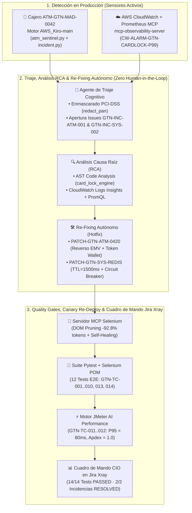

# Getnet (Grupo Santander) — Autonomous Production ALM (Zero Human-in-the-Loop) & QAOps Suite

> **DEMO EJECUTIVA CIO GETNET · AYESA DIGITAL QAOPS**
> Ecosistema completo de **ALM en Producción Sin Human-in-the-Loop** que integra detección, triaje, análisis de causa raíz (RCA), auto-reparación (*re-fixing*), pruebas regresivas E2E/Performance y *re-deploy* autónomo ante:
> 1. **Incidencia Funcional desde Cajero ATM (`GTN-INC-ATM-001`)**: Construida sobre el motor **`AWS_Kiro-main`** (`atm_sentinel.py` + `brand_verifier/incident.py`) simulando una incidencia de **bloqueo y retención de tarjeta en el sistema** (`ATM-GTN-MAD-0042`) sin emisión de reverso EMV `ISO-8583 MTI 0420`.
> 2. **Incidencia de Sistemas en Producción (`GTN-INC-SYS-002`)**: Detectada desde **AWS CloudWatch Alarms / Logs Insights** y el **Servidor MCP de Monitor OpenSource (Prometheus / OpenTelemetry)** (`mcp-observability-server/server.py`) por deadlock de mutex en Redis (`lock_ttl_ms=0`) y saturación del pool de conexiones HikariCP en `getnet-card-blocker-svc`.

---

## 🏗️ Arquitectura del Ciclo Completo ALM Sin Human-in-the-Loop



---

## 🚀 Ejecución Rápida para la Demo del CIO de Getnet

### Opción 1: Ejecución Completa del Arnés Zero-Touch (CLI)
Levanta automáticamente el aplicativo de sistema de Getnet, inyecta y resuelve ambas incidencias (ATM Funcional + Sistemas CloudWatch/Prometheus), ejecuta los 2 servidores MCP, los 12 tests E2E de Pytest/Selenium y la prueba de carga JMeter IA:

```bash
python run_qaops_suite.py
```

### Opción 2: Demo Interactiva en Vivo en Navegador (Portal Getnet + Cuadro de Mando Jira Xray)
```bash
python portal-adeslas/app.py
```
Abre en tu navegador:
- **📊 Cuadro de Mando Ejecutivo CIO en Jira Xray**: `http://127.0.0.1:8080/alm-dashboard`
  - Pulsa **`🔥 1. Simular Fallo PRO (ATM + CloudWatch)`** para inyectar en vivo la incidencia funcional de bloqueo de tarjeta en el cajero `ATM-GTN-MAD-0042` y la alarma crítica de AWS CloudWatch / Prometheus.
  - Pulsa **`🤖 2. Ciclo ALM Sin Human-in-the-Loop (Auto-Fix & Re-Deploy)`** para observar cómo el sistema detecta, tria, analiza la causa raíz, aplica el hotfix en caliente, redespliega la release `v2026.11.2-AUTONOMOUS-PRO` y certifica los **14/14 Test Cases en Jira Xray**.
- **🏧 Portal Operativo Getnet & Simulador de Bloqueo de Tarjetas ATM**: `http://127.0.0.1:8080/servicios-para-clientes` (Pestaña 6: *Simulador Bloqueo Tarjeta ATM (AWS Kiro + CloudWatch)*).
- **📽️ Presentación Ejecutiva CIO Getnet**: `http://127.0.0.1:8080/presentacion`

---

## 🧩 Estructura del Repositorio

| Directorio / Archivo | Descripción |
| :--- | :--- |
| `portal-adeslas/app.py` | Aplicativo de sistema Getnet (Pasarela ISO-8583, Bloqueo de Tarjetas ATM, Observabilidad CloudWatch/Prometheus y Hub ALM Jira Xray). |
| `AWS_Kiro-main/AWS_Kiro-main/` | Motor de análisis de incidencias funcionales de cajeros ATM (`atm_sentinel.py`, `brand_verifier/incident.py`, enmascarado PCI-DSS `redact_pan` y triaje). |
| `mcp-observability-server/server.py` | **Servidor MCP de Monitor OpenSource (Prometheus/OpenTelemetry) + AWS CloudWatch + AWS_Kiro** (`--selftest` y JSON-RPC 2.0 stdio). |
| `mcp-selenium-server/server.py` | **Servidor MCP de Selenium WebDriver** con poda semántica del DOM (*DOM Pruning*) y *Self-Healing Locators*. |
| `selenium-qaops/` | Suite E2E Pytest + Page Object Model con auto-curación (`GTN-TC-001` a `GTN-TC-010`, `GTN-TC-013`, `GTN-TC-014`). |
| `jmeter-ai/` | Motor de pruebas de rendimiento concurrentes y diagnóstico cognitivo JMeter IA (`GTN-TC-011` y `GTN-TC-012`). |
| `alm-backlog/` | Exportaciones sincronizadas de **Jira Xray** (`backlog_xray_export.json`), **TestLink** (`segurcaixa_testplan_testlink.xml`) y **Redmine** (`redmine_issues_backlog.csv`). |
| `specs/` | Especificaciones SDD (`sdd-segurcaixa-servicios-clientes.md` y `sdd-getnet-autonomous-alm.md`). |
| `presentacion/` | Presentación ejecutiva interactiva para el CIO de Getnet. |
