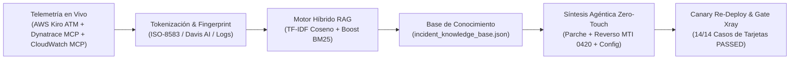

# Base de Conocimiento & Motor RAG de Comportamiento de Incidencias en Producción (Zero Human-in-the-Loop)

Este módulo (`rag-knowledge-base/`) implementa el **Modelo RAG (Retrieval-Augmented Generation)** que gobierna el comportamiento de los agentes autónomos de **Getnet (Grupo Santander)** ante incidencias funcionales y de sistemas en el dominio de **Tarjetas Bancarias**.

## 1. Arquitectura del Modelo RAG en el Ciclo ALM Autónomo

## 2. Catálogo de Playbooks Indexados (`incident_knowledge_base.json`)

| Playbook ID | Incidencia / Patrón de Comportamiento | Fuentes MCP | Remediación Autónoma (Zero-Touch) | Tests Jira Xray |
| :--- | :--- | :--- | :--- | :--- |
| **`RAG-PB-ATM-001`** | Retención física de tarjeta bancaria en cajero ATM sin reverso `ISO-8583 MTI 0420` (`EMV_LOCK_RACE_CONDITION`) | `AWS_Kiro-main` Vision Sentinel + Switch ISO-8583 | Enmascara PAN (`redact_pan`), activa `atm_emv_fallback_reversal=True`, emite `MTI 0420` y bloquea tarjeta (`BLOCKED_PREVENTIVE`). | `GTN-TC-002`, `GTN-TC-013` |
| **`RAG-PB-SYS-002`** | Deadlock de Mutex Distribuido Redis (`TTL=0`) y saturación HikariCP (`98.5%`) en bloqueo de tarjetas | **Dynatrace Davis AI** (`DT-PROB-2026-8841`) + **AWS CloudWatch** (`CW-ALARM-GTN-CARDLOCK-P99`) | Inyecta `redis_lock_ttl_ms=3000`, activa Circuit Breaker, drena conexiones colgadas y ejecuta Canary Deploy. | `GTN-TC-011`, `GTN-TC-012`, `GTN-TC-014` |
| **`RAG-PB-ISO-003`** | Fallo de autorización `3D-Secure 2.2 / ISO-8583 RC 91` en tarjetas corporativas | Dynatrace PurePath + CloudWatch Metrics | Ajusta `stip_failover_timeout_ms=1200` y activa enrutamiento Stand-In por BIN. | `GTN-TC-004`, `GTN-TC-005` |
| **`RAG-PB-PCI-004`** | Prevención de exposición de PAN en claro en trazas (PCI-DSS 4.0 Req 3.4) | `AWS_Kiro-main` (`redact_pan`) + CloudWatch Log Anomaly | Sanitización determinista pre-logging a formato `4548 **** **** 9012`. | `GTN-TC-002`, `GTN-TC-013` |
| **`RAG-PB-HSM-005`** | Desincronización de clave `ZPK/CVK` en HSM Thales durante rotación de criptogramas EMV | Dynatrace OneAgent HSM + Prometheus | Habilita ventana dual de validación criptográfica (`dual_key_grace_window_sec=300`). | `GTN-TC-004`, `GTN-TC-011` |
| **`RAG-PB-CHB-006`** | Guardrail antifraude en disputas y contracargos (Chargebacks Visa/Mastercard) de tarjetas | Portal Tarjetas Getnet + Jira Xray | Validación estricta de rango (`0 < importe <= 15.000 EUR`) y bloqueo de ejecutables (`.exe`). | `GTN-TC-007`, `GTN-TC-008`, `GTN-TC-009` |
