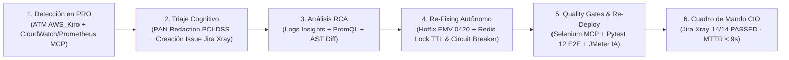

# Especificación SDD — Getnet Autonomous Production ALM (Zero Human-in-the-Loop)

Este documento complementa `specs/sdd-segurcaixa-servicios-clientes.md` y detalla la arquitectura de **Ciclo Completo ALM en Producción sin Human-in-the-Loop** para la demostración ejecutiva ante el **CIO de Getnet (Grupo Santander)**.

## 1. Arquitectura Cerrada Zero-Touch (6 Etapas Autónomas)

## 2. Invariantes de las 2 Incidencias de Producción

| ID Incidente Jira | Origen / Sensor | Síntoma en Producción | Causa Raíz (RCA) | Hotfix Autónomo (Re-Fixing) | Test Xray Verificador |
| :--- | :--- | :--- | :--- | :--- | :--- |
| **`GTN-INC-ATM-001`** | **Funcional ATM** (`AWS_Kiro-main`: `atm_sentinel.py` + `brand_verifier/incident.py`) | Tarjeta retenida en `ATM-GTN-MAD-0042` (`ERROR_TARJETA_RETENIDA_SIN_REVERSO`, HTTP 409) | `enable_emv_reversal_0420 = False` en `card_lock_engine` al bloquear por evento de ranura/PIN | Activa reverso automático `ISO-8583 MTI 0420`, libera bloqueo lógico y emite token digital | `GTN-TC-013` (`TL-GTN-113`) |
| **`GTN-INC-SYS-002`** | **Sistemas PRO** (`AWS CloudWatch` + `Prometheus OpenSource MCP Server`) | Latencia P95 = 1840 ms, saturación HikariCP (98.5%) y Deadlock Redis en `getnet-card-blocker-svc` | Lock distribuido en tabla `CARD_BLOCK_STATE` sin TTL (`redis_lock_ttl_ms = 0`) ni caché de baremos/reglas | Configura `redis_lock_ttl_ms = 1500`, activa Circuit Breaker + Caché Redis y drena pool de conexiones | `GTN-TC-014` (`TL-GTN-114`) |
